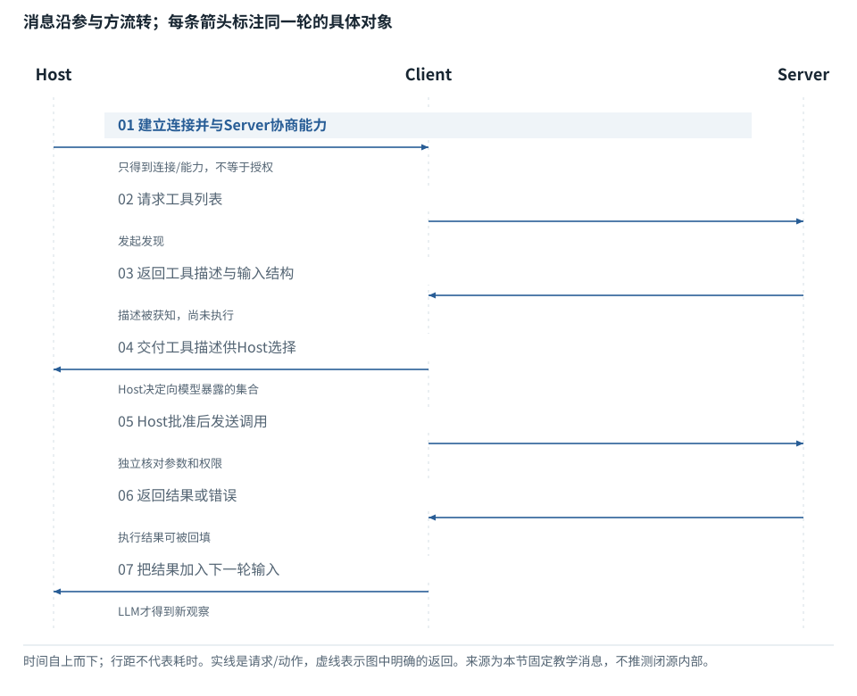

图解 · 运行过程 · 工程取舍

# MCP连起接口，不自动交出权限

连接、发现、模型可见和实际授权分别发生在哪里？

配套正文：[F25基础课](../foundations/25.md)

动态图解 · F25

## MCP连起接口，不自动交出权限

连接、发现、模型可见和实际授权分别发生在哪里？

把MCP想成工具之间的共同接口语言，而不是新大脑。Host负责应用级选择与控制，Client负责协议连接，Server提供能力。接线完成以后仍要决定哪些工具暴露给模型、哪些资源允许访问、哪些动作需要确认。

**Host**承载模型、任务与权限策略的应用。

**Client**Host中的协议客户端。

**Server**提供工具、资源等能力的服务。

**授权**允许某个身份在某个范围执行某个动作。

**输入与适用条件：**按公开架构画逻辑流程，省略具体传输和认证字段。不同协议版本的能力细节以项目声明为准。

### 1 / 7 · 1. Host建立连接，Client与Server协商能力

停留时间 4.2秒7秒1.5秒

步骤 第1步，共7步

窄屏可左右滑动图形，或点击“放大图形”。文字解释紧随图后。

Host是承载AI应用的宿主；Client是其连接特定Server的协议客户端。建立连接不是自动批准所有操作。

`本步状态由图形与说明共同给出。`

默认静止。用“下一步”看完解释再继续；播放到最后一步自动停止。键盘聚焦播放器后，可用左右键逐步查看、空格播放/暂停。图中颜色辅助区分，含义同时用文字注明。

JavaScript未启用；第一帧仍可阅读。完整图解页下方列出全部步骤说明。

## 逐步说明与计算记录

以下解释全部展开，与播放器使用同一份数据；不是另换输入的第二个算例。

### 1．1. Host建立连接，Client与Server协商能力

Host是承载AI应用的宿主；Client是其连接特定Server的协议客户端。建立连接不是自动批准所有操作。

### 2．2. Client请求可用工具列表

发现回答“有哪些接口”；不回答“本次任务是否应该用它”。

### 3．3. Server返回工具描述和输入结构

Schema描述输入形状。Server承诺能处理的工具，也可能因业务条件拒绝某次调用。

### 4．4. Host选定要向模型暴露的工具

工具存在、连接成功、模型看得到、实际被授权是四个独立问题。

### 5．5. 通过权限检查后发送调用

身份、权限和输入检查应落在可执行边界上，不能只靠Prompt说“请谨慎”。

### 6．6. 返回工具结果与错误信息

结果要带回本次调用的关联信息；错误、超时和业务拒绝需要区分。

### 7．7. Host将结果放入模型下一轮上下文

模型使用结果继续任务；协议本身不会自动创造持久记忆或提升模型参数。

### 为什么需要

减少每个工具都单独设计集成方式的成本。

### 怎样实现

先发现能力，再由宿主形成模型可见集合，最后在执行边界检查权限。

### 可能的代价与误解

外部Server的权限不会因为本地Shell受沙箱保护而自动受同样限制。

### 如何判断是否做对

分别测试“未暴露”“未授权”“参数不合法”“业务拒绝”，观察是否被准确区分。

[F22 · 把一个Agent任务拆成真正发生的几轮](F22.md)[F37 · 资料能影响模型，不代表获得了权限](F37.md)

机制来源：[[MCP]](sources.md#s-MCP) [[AGENT]](sources.md#s-AGENT)。数值和运行场景为本书明确设定的教学例；资料出处不代替本页中文解释。