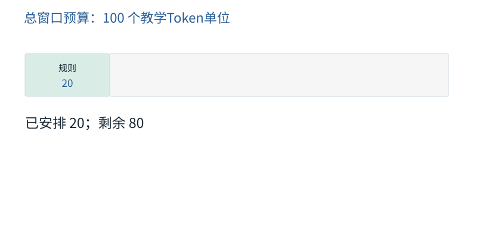

图解 · 运行过程 · 工程取舍

# 每轮上下文像一份有边界的工作资料

为什么“读得越多”有时反而越容易误解？

配套正文：[F26基础课](../foundations/26.md)

动态图解 · F26

## 每轮上下文像一份有边界的工作资料

为什么“读得越多”有时反而越容易误解？

模型这轮只能使用被提供的材料。资料过少会缺依据，过多又会引入旧版本、重复结论或无关规则。关键不是把所有可用信息填满，而是准备能支持下一步动作的最小充分资料，同时留出生成空间。

**预算**本轮允许使用的资源额度。

**必要证据**缺少它就无法可靠判断的原始信息。

**来源**这段材料是谁给的、何时有效、能支持什么结论。

**输入与适用条件：**100单位的教学预算，不是真实Tokenizer测量：规则20、任务10、工具15、证据20、输出预留20。全程同一配置。

### 1 / 5 · 加入规则

停留时间 4.2秒7秒1.5秒

步骤 第1步，共5步

窄屏可左右滑动图形，或点击“放大图形”。文字解释紧随图后。

先固定不可省略的规则；外部资料不是同等级指令。

`累计安排=20 / 100`

默认静止。用“下一步”看完解释再继续；播放到最后一步自动停止。键盘聚焦播放器后，可用左右键逐步查看、空格播放/暂停。图中颜色辅助区分，含义同时用文字注明。

JavaScript未启用；第一帧仍可阅读。完整图解页下方列出全部步骤说明。

## 逐步说明与计算记录

以下解释全部展开，与播放器使用同一份数据；不是另换输入的第二个算例。

### 1．加入规则

先固定不可省略的规则；外部资料不是同等级指令。

`累计安排=20 / 100`

### 2．加入任务

保留用户的实际目标与约束，不能只留下一个关键词。

`累计安排=30 / 100`

### 3．加入工具定义

把本轮需要的工具Schema算入预算；不需要的工具不必全部堆进来。

`累计安排=45 / 100`

### 4．加入必要证据

放入足以支持下一步决策的证据，保留来源、条件和版本。

`累计安排=65 / 100`

### 5．加入输出预留

窗口不能全塞满输入。本例输入65，预留输出20，还剩15；实际服务的计费、隐藏状态与限制口径可能不同。

`累计安排=85 / 100`

### 为什么需要

控制成本与上下文干扰，同时避免省掉关键约束。

### 怎样实现

先保证目标和证据依赖完整，再对可重新读取的细节按需加载。

### 可能的代价与误解

删除一条否定条件或其适用版本，可能让短摘要比长原文更危险。

### 如何判断是否做对

让模型用本轮材料回答关键约束与下一步证据问题，检查是否需要重新取证。

[F27 · 压缩要保留行动所依赖的事实](F27.md)[O10 · 压缩、检索与Prompt Cache：三种不同的“省”](O10.md)

机制来源：[[CONTEXT]](sources.md#s-CONTEXT)。数值和运行场景为本书明确设定的教学例；资料出处不代替本页中文解释。