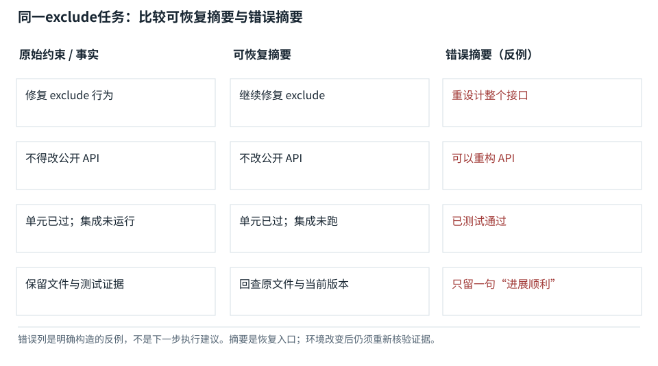

图解 · 运行过程 · 工程取舍

# 压缩要保留行动所依赖的事实

把一百轮历史压成几句话，最容易丢什么？

配套正文：[F27基础课](../foundations/27.md)

动态图解 · F27

## 压缩要保留行动所依赖的事实

把一百轮历史压成几句话，最容易丢什么？

像交班给另一位同事：对方最需要目标、禁止事项、已经做完的事、还没核实的事，以及到哪里看原证据。原始日志可以外置，但决定下一步动作的区别不能抹平。摘要也不是执行数据库，不应凭它判定不可重复动作是否已完成。

**截断**直接删掉一部分上下文。

**摘要压缩**用新文本概括旧信息，可能引入改写错误。

**快照**明确字段的当前状态记录。

**证据引用**重新获取原文的定位信息。

**输入与适用条件：**构造的exclude修复场景；有意保留“集成测试尚未运行”这一否定状态。错误摘要只作为反例，禁止当作推荐模板。

### 1 / 5 · 原历史有很多噪声

停留时间 4.2秒7秒1.5秒

步骤 第1步，共5步

窄屏可左右滑动图形，或点击“放大图形”。文字解释紧随图后。

工具输出、失败尝试和重复讨论可以很长。压缩的目标是减少历史占用，不是美化成“进度不错”。

`可恢复快照`

默认静止。用“下一步”看完解释再继续；播放到最后一步自动停止。键盘聚焦播放器后，可用左右键逐步查看、空格播放/暂停。图中颜色辅助区分，含义同时用文字注明。

JavaScript未启用；第一帧仍可阅读。完整图解页下方列出全部步骤说明。

## 逐步说明与计算记录

以下解释全部展开，与播放器使用同一份数据；不是另换输入的第二个算例。

### 1．原历史有很多噪声

工具输出、失败尝试和重复讨论可以很长。压缩的目标是减少历史占用，不是美化成“进度不错”。

`可恢复快照`

### 2．保留目标与否定约束

“不改公开API”是限制未来动作的约束，即使只占几个字，也比几百行旧日志重要。

`可恢复快照`

### 3．保留完成与未完成状态

测试结果必须带测试类型和版本。“单元已过、集成未跑”不能压成“已测试”。

`可恢复快照`

### 4．错误摘要的反例

本帧故意展示错误摘要。两个看似相近的句子允许完全不同的下一步动作，说明压缩可以丢失关键状态。

`错误对照`

### 5．恢复任务前重新读证据

新上下文依据快照继续时，还要核对文件版本与实际状态。摘要保留查证入口，但不能代替变化后的原文。

`可恢复快照`

### 为什么需要

有限窗口无法一直保留全部原始对话，但任务需要连续推进。

### 怎样实现

保留必要状态与引用，压缩后核对，再从原始来源恢复细节。

### 可能的代价与误解

摘要重写可能把猜测变结论，多轮摘要还可能累计偏移。

### 如何判断是否做对

比较压缩前后允许的下一步动作是否一致，而不只是文本相似度。

[F24 · 任务状态不是聊天里的一句总结](F24.md)[O10 · 压缩、检索与Prompt Cache：三种不同的“省”](O10.md)

机制来源：[[CONTEXT]](sources.md#s-CONTEXT)。数值和运行场景为本书明确设定的教学例；资料出处不代替本页中文解释。