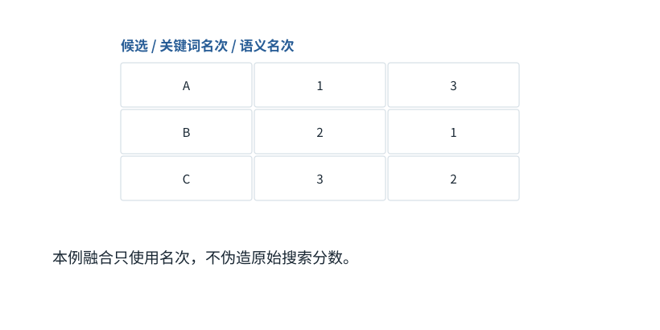

图解 · 运行过程 · 工程取舍

# 从两个候选列表，走到可用证据

“相关”与“足以回答”中间还差哪几步？

配套正文：[F29基础课](../foundations/29.md)

动态图解 · F29

## 从两个候选列表，走到可用证据

“相关”与“足以回答”中间还差哪几步？

多个检索入口可能互补。融合处理“哪些候选值得优先看”；重排对少量候选作更细比较；证据核验处理“这段话是否真的支持当前结论”。三个阶段目标不同，不能用一个相似度分数替代全部判断。

**RRF**通过名次而非原始分数融合候选列表的方法。

**重排**对召回后的候选重新作相关性排序。

**证据充分性**材料能否支持问题要求的结论和条件。

**输入与适用条件：**本图独立排名算例：关键词[A,B,C]、语义[B,C,A]、k=60。所有候选始终不变，不接用其他章节的排名数据。

### 1 / 5 · 两种搜索给出不同名次

停留时间 4.2秒7秒1.5秒

步骤 第1步，共5步

窄屏可左右滑动图形，或点击“放大图形”。文字解释紧随图后。

固定三个候选：关键词排名A、B、C；语义排名B、C、A。两种原始分数不在同一量纲，不能盲目相加。

`本步状态由图形与说明共同给出。`

默认静止。用“下一步”看完解释再继续；播放到最后一步自动停止。键盘聚焦播放器后，可用左右键逐步查看、空格播放/暂停。图中颜色辅助区分，含义同时用文字注明。

JavaScript未启用；第一帧仍可阅读。完整图解页下方列出全部步骤说明。

## 逐步说明与计算记录

以下解释全部展开，与播放器使用同一份数据；不是另换输入的第二个算例。

### 1．两种搜索给出不同名次

固定三个候选：关键词排名A、B、C；语义排名B、C、A。两种原始分数不在同一量纲，不能盲目相加。

### 2．计算候选A的融合贡献

RRF把每次出现的排名变成1/(60+排名)，再相加。候选A的两个名次为[1, 3]，融合分数约0.03226646。

RRF(A)=0.03226646

### 3．计算候选B的融合贡献

RRF把每次出现的排名变成1/(60+排名)，再相加。候选B的两个名次为[2, 1]，融合分数约0.03252247。

RRF(B)=0.03252247

### 4．计算候选C的融合贡献

RRF把每次出现的排名变成1/(60+排名)，再相加。候选C的两个名次为[3, 2]，融合分数约0.03200205。

RRF(C)=0.03200205

### 5．B排第一，但还不是最终答案

固定排名下结果B、A、C。还要用原文证据、版本和权限判断适用性。排第一仅代表这个融合规则给的优先级。

`排序=B,A,C`

### 为什么需要

精确词项与语义线索各有盲区，组合能提供互补候选。

### 怎样实现

先融合候选，再核实原文与元数据，必要时补查缺失证据。

### 可能的代价与误解

提高Top-k可能把更多无关内容塞入上下文；检索器成绩提升不一定带来任务成功率提升。

### 如何判断是否做对

分别测召回、排名和最终回答支持度；不要只测最终一项或只测搜索分数。

[F28 · 检索先找候选，再判断能否回答](F28.md)[O10 · 压缩、检索与Prompt Cache：三种不同的“省”](O10.md)

机制来源：[[RETRIEVAL]](sources.md#s-RETRIEVAL)。数值和运行场景为本书明确设定的教学例；资料出处不代替本页中文解释。