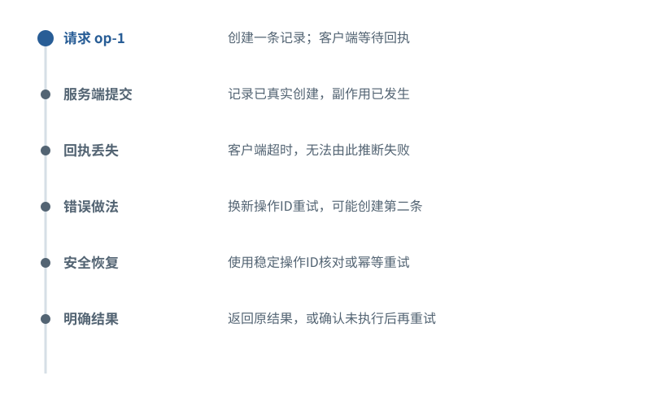

图解 · 运行过程 · 工程取舍

# 超时告诉你没收到，不告诉你没发生

为什么自动重试有时会把一次工作做两遍？

配套正文：[F33基础课](../foundations/33.md)

动态图解 · F33

## 超时告诉你没收到，不告诉你没发生

为什么自动重试有时会把一次工作做两遍？

外部服务可能已经完成动作，只是成功消息没回到调用方。此时“未知”是精确状态，不是系统不够聪明。对于会产生新记录、发送消息等副作用的动作，恢复需要稳定操作标识、结果核对或服务支持的幂等语义。只读查询的重试通常不需要同样复杂的设计。

**幂等**重复同一逻辑操作不产生额外副作用。

**操作ID**标识同一次逻辑动作，重试不随意换新ID。

**事务**在某个明确系统边界内保证一致性的机制。

**输入与适用条件：**构造的外部写入场景；不承诺跨数据库、文件系统和远程API天然具备“恰好一次”事务。

### 1 / 6 · 请求 op-1

停留时间 4.2秒7秒1.5秒

步骤 第1步，共6步

窄屏可左右滑动图形，或点击“放大图形”。文字解释紧随图后。

创建一条记录；客户端等待回执

`教学状态`

默认静止。用“下一步”看完解释再继续；播放到最后一步自动停止。键盘聚焦播放器后，可用左右键逐步查看、空格播放/暂停。图中颜色辅助区分，含义同时用文字注明。

JavaScript未启用；第一帧仍可阅读。完整图解页下方列出全部步骤说明。

## 逐步说明与计算记录

以下解释全部展开，与播放器使用同一份数据；不是另换输入的第二个算例。

### 1．请求 op-1

创建一条记录；客户端等待回执

`教学状态`

### 2．服务端提交

记录已真实创建，副作用已发生

`教学状态`

### 3．回执丢失

客户端超时，无法由此推断失败

`unknown`

### 4．错误做法

换新操作ID重试，可能创建第二条

`反例`

### 5．安全恢复

使用稳定操作ID核对或幂等重试

`教学状态`

### 6．明确结果

返回原结果，或确认未执行后再重试

`教学状态`

### 为什么需要

在不可靠网络下维持正确副作用次数。

### 怎样实现

先判断操作是否可重复，再决定重试、查状态、对账或人工确认。

### 可能的代价与误解

只在本地记一个成功标志，不能消除“远端已提交、本地未记录”的窗口。

### 如何判断是否做对

故意丢回执并重试，核对最终仅存在一条逻辑记录。

[F24 · 任务状态不是聊天里的一句总结](F24.md)[F37 · 资料能影响模型，不代表获得了权限](F37.md)

机制来源：[[STATE]](sources.md#s-STATE)。数值和运行场景为本书明确设定的教学例；资料出处不代替本页中文解释。