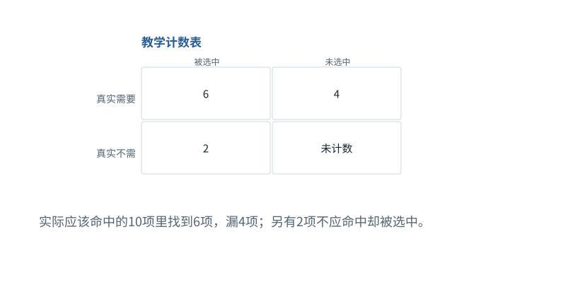

图解 · 运行过程 · 工程取舍

# 读指标，先问它的分母是谁

为什么精确率高不等于证据找全了？

配套正文：[F35基础课](../foundations/35.md)

动态图解 · F35

## 读指标，先问它的分母是谁

为什么精确率高不等于证据找全了？

分子看起来都是“找对了多少”，分母却在回答不同问题。精确率从已拿回的内容看浪费；召回率从真正需要的内容看遗漏。Agent任务成功率又是另一层结果，不能把检索指标直接当作整个任务成功率。

**TP**该选且确实选中的项。

**FP**不该选却选中的项。

**FN**应该选却漏掉的项。

**评测单位**一次任务、一次运行、一个文档或一个位置，必须先定清。

**输入与适用条件：**本图始终TP=6、FP=2、FN=4；未定义TN，不计算准确率。与其他章节不同样本的百分比不可直接拼接。

### 1 / 4 · 四种结果先分开

停留时间 4.2秒7秒1.5秒

步骤 第1步，共4步

窄屏可左右滑动图形，或点击“放大图形”。文字解释紧随图后。

实际应该命中的10项里找到6项，漏4项；另有2项不应命中却被选中。

`TP=6, FP=2, FN=4`

Precision=6/8；Recall=6/10

默认静止。用“下一步”看完解释再继续；播放到最后一步自动停止。键盘聚焦播放器后，可用左右键逐步查看、空格播放/暂停。图中颜色辅助区分，含义同时用文字注明。

JavaScript未启用；第一帧仍可阅读。完整图解页下方列出全部步骤说明。

## 逐步说明与计算记录

以下解释全部展开，与播放器使用同一份数据；不是另换输入的第二个算例。

### 1．四种结果先分开

实际应该命中的10项里找到6项，漏4项；另有2项不应命中却被选中。

`TP=6, FP=2, FN=4`

Precision=6/8；Recall=6/10

### 2．精确率看选中的集合

系统选中8项，其中6项正确；精确率6/8=75%。它回答“拿回来的有多少能用”。

`TP=6, FP=2, FN=4`

Precision=6/8；Recall=6/10

### 3．召回率看真正需要的集合

真正需要10项，找到6项；召回率6/10=60%。它回答“需要的漏了多少”。

`TP=6, FP=2, FN=4`

Precision=6/8；Recall=6/10

### 4．不能只优化一个数

只返回最有把握的一项可能提高精确率，却漏掉大量必要证据；返回所有东西能提高召回，却让上下文充满无关内容。

`TP=6, FP=2, FN=4`

Precision=6/8；Recall=6/10

### 为什么需要

用准确的指标发现遗漏或浪费，而不被单个漂亮百分比误导。

### 怎样实现

明确任务集与单位，再计算分子分母，同时看下游任务表现。

### 可能的代价与误解

一题跑十次不是十道独立题；重试成功率与单次成功率也不同。

### 如何判断是否做对

从原始记录重算指标，逐项检查是否重复计数或遗漏失败。

[F36 · 涨了10个百分点，为什么还不能急着下结论？](F36.md)[F40 · 先找错误发生在哪层，再谈换模型](F40.md)

机制来源：[[EVAL]](sources.md#s-EVAL)。数值和运行场景为本书明确设定的教学例；资料出处不代替本页中文解释。