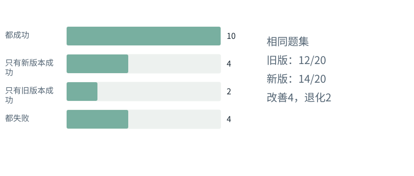

图解 · 运行过程 · 工程取舍

# 涨了10个百分点，为什么还不能急着下结论？

一次实验怎样区别真实改进与偶然波动？

配套正文：[F36基础课](../foundations/36.md)

动态图解 · F36

## 涨了10个百分点，为什么还不能急着下结论？

一次实验怎样区别真实改进与偶然波动？

像给同一组题换两种解法：同题对照能减少题目难度不同带来的干扰。统计方法帮助表达不确定性，不会自动告诉你退化是否可接受、成本是否值得。实际决策还要回到任务类型、失误严重性和重复表现。

**配对**同一任务同时有新旧方案结果。

**百分点**两个百分率直接相减，如70%−60%=10个百分点。

**随机波动**在相同条件下多次运行也可能有不同结果。

**输入与适用条件：**构造的20题配对表：10都成、4新成旧败、2旧成新败、4都败。不把它当真实模型胜率。

### 1 / 5 · 同20题，两版各跑一次

停留时间 4.2秒7秒1.5秒

步骤 第1步，共5步

窄屏可左右滑动图形，或点击“放大图形”。文字解释紧随图后。

配对意味着旧版和新版面对同一题。先列出两者在每道题上的成功与失败关系，而不是只看两个总分。

`20个配对任务；不是40个独立任务`

默认静止。用“下一步”看完解释再继续；播放到最后一步自动停止。键盘聚焦播放器后，可用左右键逐步查看、空格播放/暂停。图中颜色辅助区分，含义同时用文字注明。

JavaScript未启用；第一帧仍可阅读。完整图解页下方列出全部步骤说明。

## 逐步说明与计算记录

以下解释全部展开，与播放器使用同一份数据；不是另换输入的第二个算例。

### 1．同20题，两版各跑一次

配对意味着旧版和新版面对同一题。先列出两者在每道题上的成功与失败关系，而不是只看两个总分。

`20个配对任务；不是40个独立任务`

### 2．旧版12题成功

旧版成功=10道双方成功＋2道仅旧版成功，得到12/20=60%。

`20个配对任务；不是40个独立任务`

### 3．新版14题成功

新版成功=10道双方成功＋4道仅新版成功，得到14/20=70%。净提升是2题，即10个百分点。

`20个配对任务；不是40个独立任务`

### 4．改进与退化同时存在

新版改善4题，也退化2题。不能只展示改善案例；小样本的一次结果还不足以宣称稳定提升。

`20个配对任务；不是40个独立任务`

### 5．回到具体失败原因

检查两道退化题是否涉及权限、任务类型、上下文或测试环境变化，再做受控重复与成本比较。

`20个配对任务；不是40个独立任务`

### 为什么需要

避免因一个小样本的好看结果就把优化推向全部任务。

### 怎样实现

固定题集、版本和预算，配对重复，记录退化，并检查置信区间等不确定性。

### 可能的代价与误解

只保留成功重跑、反复调参又用同一评测集验收，会高估能力。

### 如何判断是否做对

重算全部配对原始记录，报告净提升、退化和成本，而不是只报均值。

[F35 · 读指标，先问它的分母是谁](F35.md)[F38 · Trace要告诉你因果，不只是时间戳](F38.md)

机制来源：[[EVAL]](sources.md#s-EVAL)。数值和运行场景为本书明确设定的教学例；资料出处不代替本页中文解释。