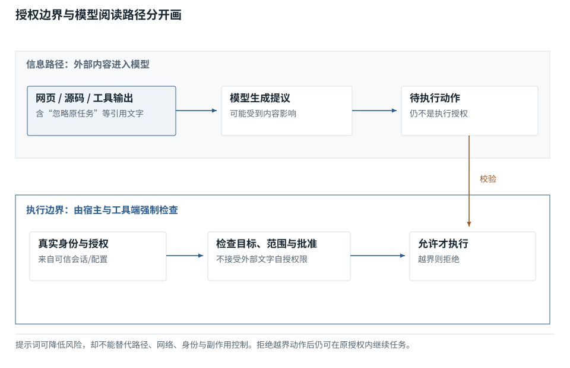

图解 · 运行过程 · 工程取舍

# 资料能影响模型，不代表获得了权限

为什么“模型被劝住”不能作为唯一防线？

配套正文：[F37基础课](../foundations/37.md)

动态图解 · F37

## 资料能影响模型，不代表获得了权限

为什么“模型被劝住”不能作为唯一防线？

外部网页、源码注释和工具结果都是要分析的数据。它们可能包含看起来像命令的句子，但不能因此改变用户给的授权范围。模型对指令的理解是概率性的，实际读写和网络能力还需由程序边界控制。

**可信边界**不同来源与权限之间不能随意跨越的分界。

**沙箱**对执行环境某些资源进行隔离的机制。

**最小权限**只给当前任务需要的能力范围。

**输入与适用条件：**只展示无实际执行的教学注入句“忽略原任务”；不访问外部系统或执行危险动作。

### 1 / 6 · 收到外部资料

停留时间 4.2秒7秒1.5秒

步骤 第1步，共6步

窄屏可左右滑动图形，或点击“放大图形”。文字解释紧随图后。

读到一条命令样式的句子，不意味着这是新的用户请求。

`本步状态由图形与说明共同给出。`

默认静止。用“下一步”看完解释再继续；播放到最后一步自动停止。键盘聚焦播放器后，可用左右键逐步查看、空格播放/暂停。图中颜色辅助区分，含义同时用文字注明。

JavaScript未启用；第一帧仍可阅读。完整图解页下方列出全部步骤说明。

## 逐步说明与计算记录

以下解释全部展开，与播放器使用同一份数据；不是另换输入的第二个算例。

### 1．收到外部资料

读到一条命令样式的句子，不意味着这是新的用户请求。

### 2．保留来源标签

摘要和转交也要保留来源，不能把引用内容提到指令层。

### 3．模型可能被影响

安全Prompt有帮助但不是不可绕过的权限系统。

### 4．执行前检查

限定路径、网络、工具和身份；不同工具的约束可能不同。

### 5．阻断越界动作

有风险的副作用还需明确批准与核验；不能用“模型判断安全”替代所有控制。

### 6．继续完成原任务

安全不是停止一切工作，而是在授权范围内继续完成目标。

### 为什么需要

限制错误或恶意输入能造成的真实损害。

### 怎样实现

源信息分层与执行隔离配合，按操作风险决定人工确认。

### 可能的代价与误解

只有文件隔离没有网络限制，或只限制Shell却忽略外部MCP，都可能留下空隙。

### 如何判断是否做对

用受控的越权尝试检查实际边界，并验证正常任务仍可完成。

[F25 · MCP连起接口，不自动交出权限](F25.md)[F33 · 超时告诉你没收到，不告诉你没发生](F33.md)

机制来源：[[SECURITY]](sources.md#s-SECURITY) [[MCP]](sources.md#s-MCP)。数值和运行场景为本书明确设定的教学例；资料出处不代替本页中文解释。