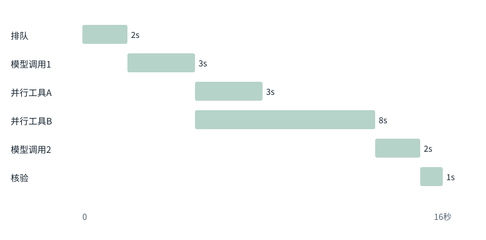

图解 · 运行过程 · 工程取舍

# Trace要告诉你因果，不只是时间戳

为何优化一个最显眼的步骤，整体却没变快？

配套正文：[F38基础课](../foundations/38.md)

动态图解 · F38

## Trace要告诉你因果，不只是时间戳

为何优化一个最显眼的步骤，整体却没变快？

执行轨迹像工程里的时间账，但更重要的是依赖关系。串行阶段会相加，并行阶段往往取关键路径；只有知道下一步在等谁，才能知道哪里值得优化。还要把排队、推理、工具、验证和重试分开，不能全算成模型慢。

**Trace**一条任务中各步骤及关联关系的记录。

**墙钟时间**从任务开始到结束真正经过多久。

**关键路径**决定完成时间的依赖链。

**吞吐**单位时间完成多少任务。

**输入与适用条件：**固定教学秒数，无真实产品耗时数据。第4帧只改变工具A时长，其他条件保持不变。

### 1 / 5 · 先看一条完整任务

停留时间 4.2秒7秒1.5秒

步骤 第1步，共5步

窄屏可左右滑动图形，或点击“放大图形”。文字解释紧随图后。

构造的任务从0到16秒：排队2秒、第一次模型3秒、并行工具A3秒/B8秒、第二次模型2秒、核验1秒。

`基准墙钟16秒；工具工作量11秒`

默认静止。用“下一步”看完解释再继续；播放到最后一步自动停止。键盘聚焦播放器后，可用左右键逐步查看、空格播放/暂停。图中颜色辅助区分，含义同时用文字注明。

JavaScript未启用；第一帧仍可阅读。完整图解页下方列出全部步骤说明。

## 逐步说明与计算记录

以下解释全部展开，与播放器使用同一份数据；不是另换输入的第二个算例。

### 1．先看一条完整任务

构造的任务从0到16秒：排队2秒、第一次模型3秒、并行工具A3秒/B8秒、第二次模型2秒、核验1秒。

`基准墙钟16秒；工具工作量11秒`

### 2．两个工具同时开始

A在8秒完成，但B直到13秒才完成。若下一轮需要两者结果，就由B决定等待长度。

`基准墙钟16秒；工具工作量11秒`

### 3．墙钟不是每行简单相加

工具工作量3+8=11秒，工具阶段墙钟却是8秒。任务墙钟是2+3+8+2+1=16秒。

`基准墙钟16秒；工具工作量11秒`

### 4．优化不在关键路径的A

若只把A从3秒缩成1秒，B仍占8秒，整体仍约16秒。这个简化图中，优化A不缩短关键路径。

`基准墙钟16秒；工具工作量11秒`

### 5．再考虑队列与成本

把B缩短可能缩短任务；但更多并发也可能增加系统排队和资源争用。需要在真实负载下重新测量。

`基准墙钟16秒；工具工作量11秒`

### 为什么需要

把优化投入到确实支配成本或完成时间的环节。

### 怎样实现

按依赖关系画时间线，再用同负载实测对照。

### 可能的代价与误解

只看平均值会隐藏长尾；把并行跨度相加会错误夸大总耗时。

### 如何判断是否做对

按时间戳与依赖重算16秒，检查是否把等待和重试遗漏。

[F21 · 算得慢，可能是东西搬得慢](F21.md)[O06 · 连续组批：有座位空出来，就接下一位](O06.md)[O11 · 多Agent：可并行的工作，比Agent数量重要](O11.md)

机制来源：[[TRACE]](sources.md#s-TRACE)。数值和运行场景为本书明确设定的教学例；资料出处不代替本页中文解释。