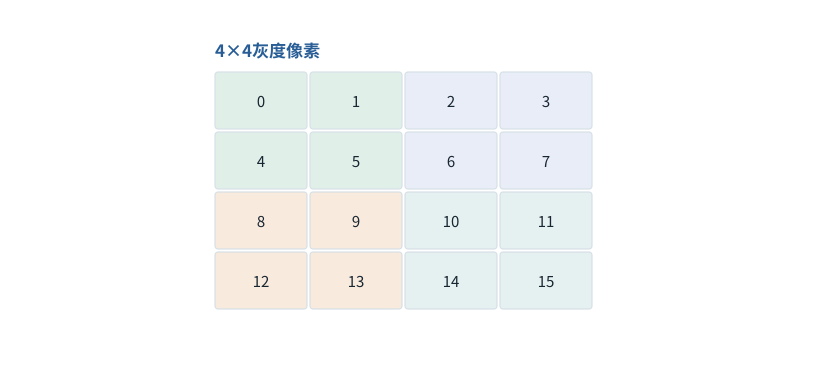

图解 · 运行过程 · 工程取舍

# 图像表示与界面行动，是两层不同问题

为什么看得懂截图，也可能点错按钮？

配套正文：[F39基础课](../foundations/39.md)

动态图解 · F39

## 图像表示与界面行动，是两层不同问题

为什么看得懂截图，也可能点错按钮？

图像编码解决“把视觉信息变成可计算表示”；界面控制解决“在真实软件的当前状态做正确动作”。静态图里的坐标、页面当前布局、点击结果必须连接起来。模型对图片的描述再流畅，也不能替代操作后确认。

**Patch**图像被切分出的一小块。

**视觉编码器**把像素处理成模型可用表示的网络。

**Grounding**把指令对象定位到具体界面元素或坐标。

**输入与适用条件：**仅4×4灰度像素与构造界面流程；不代表所有多模态模型的预处理实现，也不冒充真实浏览器操控结果。

### 1 / 4 · 图像也是规则数字表

停留时间 4.2秒7秒1.5秒

步骤 第1步，共4步

窄屏可左右滑动图形，或点击“放大图形”。文字解释紧随图后。

独立的4×4灰度教学图，每格是一个像素值。真实彩色图还会有颜色通道；像素值不等于文字Token ID。

`本步状态由图形与说明共同给出。`

默认静止。用“下一步”看完解释再继续；播放到最后一步自动停止。键盘聚焦播放器后，可用左右键逐步查看、空格播放/暂停。图中颜色辅助区分，含义同时用文字注明。

JavaScript未启用；第一帧仍可阅读。完整图解页下方列出全部步骤说明。

## 逐步说明与计算记录

以下解释全部展开，与播放器使用同一份数据；不是另换输入的第二个算例。

### 1．图像也是规则数字表

独立的4×4灰度教学图，每格是一个像素值。真实彩色图还会有颜色通道；像素值不等于文字Token ID。

### 2．分成四个2×2小块

每个Patch展开成四个数。这里恰好有四块，而不是16个文本Token。图块顺序和位置还需明确。

### 3．视觉编码不是通用事实解析器

视觉编码器、投影或其他接口把图像信息交给语言模型。具体架构不同，视觉Token数量不能仅凭4×4图片大小套一个统一公式。

### 4．界面行动需要重新观察

看到按钮在坐标x,y并不意味着下一时刻还在那里。截图后页面可能滚动、弹窗或变更布局；点击后的新观察用于确认实际状态。

`坐标必须绑定截图尺寸与页面状态`

### 为什么需要

让模型处理非文本信息，同时让实际界面动作可核验。

### 怎样实现

区分表示链与行动链；可靠API存在时优先用结构化接口。

### 可能的代价与误解

裁剪缩放坐标错位、截图过期、视觉幻觉、点击重试副作用。

### 如何判断是否做对

核对像素块顺序与坐标变换；每次行动后观察环境变化。

[F33 · 超时告诉你没收到，不告诉你没发生](F33.md)[F37 · 资料能影响模型，不代表获得了权限](F37.md)

机制来源：[[VISION]](sources.md#s-VISION)。数值和运行场景为本书明确设定的教学例；资料出处不代替本页中文解释。