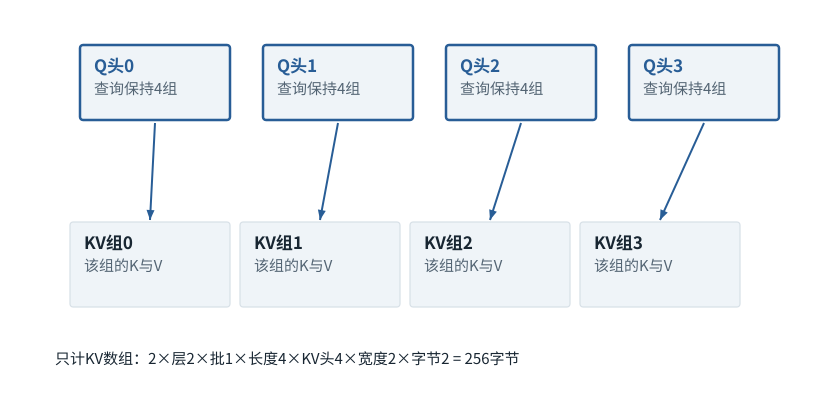

图解 · 运行过程 · 工程取舍

# GQA/MQA：减少的是K/V组数

为什么查询头数没变，缓存却可以变小？

动态图解 · O01

## GQA/MQA：减少的是K/V组数

为什么查询头数没变，缓存却可以变小？

多名接收者可以共用一套提供者表示；查询仍有不同的比较方式。减少K/V组数让每个位置要保存的历史内容变少，但模型结构也发生了变化，不能期待任意已有模型不经适配就得到完全一样的输出。

**Hq**查询头数量。

**Hkv**Key/Value的组数。

**头宽度**每个头里的一排特征有多长。

**输入与适用条件：**独立资源计数：2层、批1、序列4、4个查询头、每头宽2、每数2字节；只改K/V组数4→2→1。

### 1 / 4 · MHA：每个查询头有自己的K/V

停留时间 4.2秒7秒1.5秒

步骤 第1步，共4步

窄屏可左右滑动图形，或点击“放大图形”。文字解释紧随图后。

共享的是K/V组，不是取消查询头，也不是给旧模型随意少算几个头。结构改变通常需要匹配的模型训练或转换方案。

`Hq=4；Hkv=4；KV=256 bytes`

默认静止。用“下一步”看完解释再继续；播放到最后一步自动停止。键盘聚焦播放器后，可用左右键逐步查看、空格播放/暂停。图中颜色辅助区分，含义同时用文字注明。

JavaScript未启用；第一帧仍可阅读。完整图解页下方列出全部步骤说明。

## 逐步说明与计算记录

以下解释全部展开，与播放器使用同一份数据；不是另换输入的第二个算例。

### 1．MHA：每个查询头有自己的K/V

共享的是K/V组，不是取消查询头，也不是给旧模型随意少算几个头。结构改变通常需要匹配的模型训练或转换方案。

`Hq=4；Hkv=4；KV=256 bytes`

### 2．GQA：每两个查询头共享一组K/V

共享的是K/V组，不是取消查询头，也不是给旧模型随意少算几个头。结构改变通常需要匹配的模型训练或转换方案。

`Hq=4；Hkv=2；KV=128 bytes`

### 3．MQA：所有查询头共享一组K/V

共享的是K/V组，不是取消查询头，也不是给旧模型随意少算几个头。结构改变通常需要匹配的模型训练或转换方案。

`Hq=4；Hkv=1；KV=64 bytes`

### 4．减小缓存，不保证原输出逐位不变

GQA/MQA改变模型结构和参数关系。不能把它和保持相同数学注意力的FlashAttention混为一谈；质量需要针对模型任务重新验证。

### 为什么需要

长序列或多并发时KV内存和读取带宽压力很大。

### 怎样实现

使用训练/适配好的分组查询架构，并让运行时按正确组映射读取。

### 可能的代价与误解

可能改变质量；若实现物理复制共享K/V，实际内存收益会被抵消。

### 如何判断是否做对

分别验证组映射、内存实占、任务质量和速度；不能只看理论字节数。

[F11 · Q/K/V：先算从哪读，再算读进多少](F11.md)[F19 · KV Cache：留下算过的，不省掉该读的](F16.md)[O04 · FlashAttention：一边读一边累计，不攒整张表](O04.md)

机制来源：[[GQA]](sources.md#s-GQA)。数值和运行场景为本书明确设定的教学例；资料出处不代替本页中文解释。