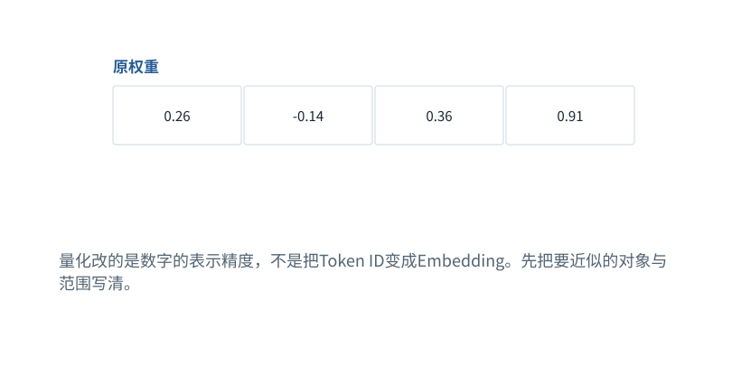

图解 · 运行过程 · 工程取舍

# 量化：省存储，也引入近似

为什么“4bit”不等于所有模型内存都缩到八分之一？

动态图解 · O02

## 量化：省存储，也引入近似

为什么“4bit”不等于所有模型内存都缩到八分之一？

像把精细刻度换成较粗刻度：需要的存储位数减少，但有些原值只能落到相邻刻度，还有些会超出可表示范围。尺度、分组信息、未量化层、激活与缓存仍占空间，因此不能只数权重整数的位数就当作运行总内存。

**尺度scale**一个整数刻度对应多大的实数间隔。

**舍入**取邻近可表示值。

**裁剪**把超范围值截到边界，通常产生更大的误差。

**输入与适用条件：**固定权重[0.26,−0.14,0.36,0.91]，尺度0.1，有符号范围[−8,7]。只是均匀量化小例，不等于NF4或所有实际4bit格式。

### 1 / 4 · 原来的四个浮点数

停留时间 4.2秒7秒1.5秒

步骤 第1步，共4步

窄屏可左右滑动图形，或点击“放大图形”。文字解释紧随图后。

量化改的是数字的表示精度，不是把Token ID变成Embedding。先把要近似的对象与范围写清。

`[[0.26, -0.14, 0.36, 0.91]]`

q=clip(round(x/0.1),−8,7)；x近似=0.1q

默认静止。用“下一步”看完解释再继续；播放到最后一步自动停止。键盘聚焦播放器后，可用左右键逐步查看、空格播放/暂停。图中颜色辅助区分，含义同时用文字注明。

JavaScript未启用；第一帧仍可阅读。完整图解页下方列出全部步骤说明。

## 逐步说明与计算记录

以下解释全部展开，与播放器使用同一份数据；不是另换输入的第二个算例。

### 1．原来的四个浮点数

量化改的是数字的表示精度，不是把Token ID变成Embedding。先把要近似的对象与范围写清。

`[[0.26, -0.14, 0.36, 0.91]]`

q=clip(round(x/0.1),−8,7)；x近似=0.1q

### 2．除以尺度并取最近整数

本例尺度0.1，先除以0.1，再取最近整数，得到[3,−1,4,9]。这一步已经有舍入误差。

`[[3, -1, 4, 9]]`

q=clip(round(x/0.1),−8,7)；x近似=0.1q

### 3．4bit有符号范围不够

教学4bit有符号整数取值−8到7。9超出范围，只能裁剪到7；大值误差可能远高于普通舍入误差。

`[[3, -1, 4, 7]]`

q=clip(round(x/0.1),−8,7)；x近似=0.1q

### 4．近似还原，检查误差

乘回尺度0.1，得到[0.3,−0.1,0.4,0.7]。最后一项相对原0.91差−0.21，展示了溢出范围的风险。

`[[0.30000000000000004, -0.1, 0.4, 0.7000000000000001], [0.040000000000000036, 0.04000000000000001, 0.040000000000000036, -0.20999999999999996]]`

q=clip(round(x/0.1),−8,7)；x近似=0.1q

### 为什么需要

减少权重或KV等对象的存储与搬运压力。

### 怎样实现

选清量化对象和格式，校准范围，使用匹配内核，逐层或任务级验证。

### 可能的代价与误解

误差、异常值、反量化开销、缺少高效内核，都可能削弱质量或速度收益。

### 如何判断是否做对

对比原值与还原值；更重要的是比较真实任务表现与实测峰值内存。

[F06 · 数据搬到GPU，改变的是位置而不是含义](F06.md)[F20 · 省参数、省位数、少激活不是同一种优化](F20.md)

机制来源：[[QLORA]](sources.md#s-QLORA)。数值和运行场景为本书明确设定的教学例；资料出处不代替本页中文解释。