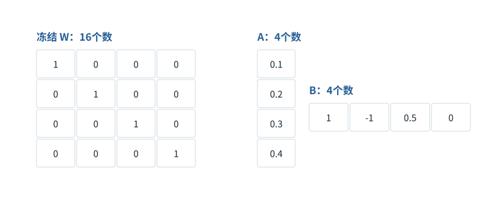

图解 · 运行过程 · 工程取舍

# LoRA：冻结大表，学习小增量

减少的是整个模型，还是需要更新的参数？

动态图解 · O03

## LoRA：冻结大表，学习小增量

减少的是整个模型，还是需要更新的参数？

把基础权重看成已有配方。LoRA不把配方丢掉，而是用两张小表描述修改量。训练时主要改小表，减少可训练参数及相关优化器状态；但运行仍要用基础模型，增量容量也受秩限制。

**冻结**本次训练不更新该参数，不表示不读取或不参与前向。

**秩r**增量能表达的独立方向数的上限。

**合并**在适用条件下把增量加回基础权重供推理。

**输入与适用条件：**独立小例：W为4×4单位矩阵，r=1，A=[[.1],[.2],[.3],[.4]]，B=[[1,−1,.5,0]]，x=[1,0,0,0]，缩放1。

### 1 / 4 · 原权重并没有被删除

停留时间 4.2秒7秒1.5秒

步骤 第1步，共4步

窄屏可左右滑动图形，或点击“放大图形”。文字解释紧随图后。

基准W是4×4单位矩阵，共16个参数。LoRA冻结这16个数，另外准备4×1的A和1×4的B，共8个可训练数。

`本步状态由图形与说明共同给出。`

默认静止。用“下一步”看完解释再继续；播放到最后一步自动停止。键盘聚焦播放器后，可用左右键逐步查看、空格播放/暂停。图中颜色辅助区分，含义同时用文字注明。

JavaScript未启用；第一帧仍可阅读。完整图解页下方列出全部步骤说明。

## 逐步说明与计算记录

以下解释全部展开，与播放器使用同一份数据；不是另换输入的第二个算例。

### 1．原权重并没有被删除

基准W是4×4单位矩阵，共16个参数。LoRA冻结这16个数，另外准备4×1的A和1×4的B，共8个可训练数。

### 2．两张小表表示一个增量

增量ΔW=A×B，最多只有秩1。它只表达允许的变化方向，不承诺任意完整4×4更新都能这样表示。

### 3．输出是原路径加增量路径

固定x=[1,0,0,0]，缩放系数1。xW=[1,0,0,0]；xAB=[0.1,−0.1,0.05,0]；相加得到[1.1,−0.1,0.05,0]。

### 4．训练少了，不等于推理自动更快

适当合并增量可避免额外推理分支，但合并、精度和多适配器切换都要考虑。LoRA主要优化微调资源，不保证所有端到端任务更快。

### 为什么需要

全量微调所需梯度和优化器状态可能太大。

### 怎样实现

冻结基础权重，训练低秩增量，保留正确缩放和模块匹配。

### 可能的代价与误解

小秩可能限制能力；基础模型与适配器版本不匹配；低精度合并有数值差异。

### 如何判断是否做对

验证x(W+AB)=xW+xAB，再做独立任务质量与资源对照。

[F20 · 省参数、省位数、少激活不是同一种优化](F20.md)[O09 · Activation Checkpointing：少存一点，反向时重算](O09.md)

机制来源：[[LORA]](sources.md#s-LORA)。数值和运行场景为本书明确设定的教学例；资料出处不代替本页中文解释。