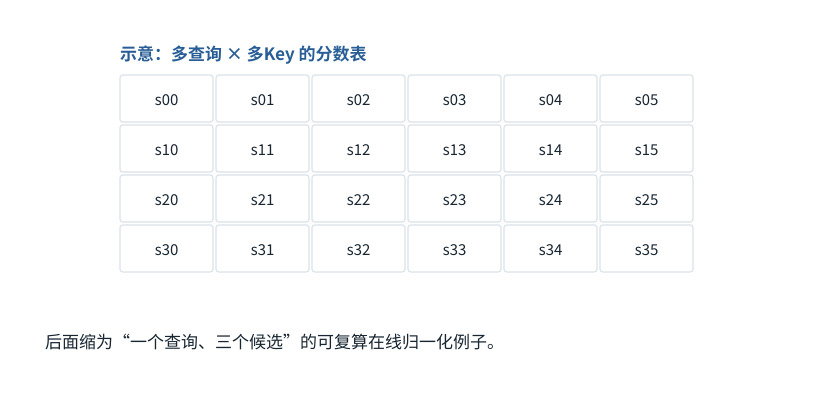

图解 · 运行过程 · 工程取舍

# FlashAttention：一边读一边累计，不攒整张表

不把完整注意力表存下来，怎样仍算出同一输出？

动态图解 · O04

## FlashAttention：一边读一边累计，不攒整张表

不把完整注意力表存下来，怎样仍算出同一输出？

想象分批称重汇总：每批到来时更新“最大刻度、总重量、内容加权和”，不用把所有中间单据再写一遍显存。最大刻度变化时，旧累计必须跟着换刻度。这个在线归一化过程解释了省读写如何与同一数学结果兼容。

**m**截至当前分块的最大分数。

**l**按当前最大值缩放后的指数总和。

**加权累计**尚未除以l的Value贡献和。

**输入与适用条件：**独立单查询例：读取顺序C/A/B，分数[0,2,1]，对应V为[[5,5],[10,0],[0,20]]。为展示最大值变化而设，不接用F09候选顺序。

### 1 / 5 · 普通写法先想象整张分数表

停留时间 4.2秒7秒1.5秒

步骤 第1步，共5步

窄屏可左右滑动图形，或点击“放大图形”。文字解释紧随图后。

在长序列中，把所有查询对所有Key的分数完整存下来会产生很大的中间表。FlashAttention改变分块与读写组织，目标不是随意丢弃低分位置。

`本步状态由图形与说明共同给出。`

默认静止。用“下一步”看完解释再继续；播放到最后一步自动停止。键盘聚焦播放器后，可用左右键逐步查看、空格播放/暂停。图中颜色辅助区分，含义同时用文字注明。

JavaScript未启用；第一帧仍可阅读。完整图解页下方列出全部步骤说明。

## 逐步说明与计算记录

以下解释全部展开，与播放器使用同一份数据；不是另换输入的第二个算例。

### 1．普通写法先想象整张分数表

在长序列中，把所有查询对所有Key的分数完整存下来会产生很大的中间表。FlashAttention改变分块与读写组织，目标不是随意丢弃低分位置。

### 2．在线处理第1个候选

先读C，分数0、V=[5,5]。最大值0，指数和1，加权和[5,5]。

`m=0.000000；l=1.000000`

输出=[5.000000,5.000000]

### 3．在线处理第2个候选

读A后最大值从0升为2。旧累计先乘exp(0−2)，新A按exp(2−2)=1加入；不重新缩放旧累计会算错。

`m=2.000000；l=1.135335`

输出=[9.403985,0.596015]

### 4．在线处理第3个候选

最后读B，最大值仍是2，加入exp(1−2)与对应V贡献。最终用累计加权和除累计指数和，得到与完整softmax相同的数学结果。

`m=2.000000；l=1.503215`

输出=[7.102562,5.344722]

### 5．同一结果，减少的是中间读写

小例验证在线归一化的正确性；真正FlashAttention还按硬件块执行矩阵乘和前后向。它是算法/内核实现优化，不意味着Attention的所有计算降为线性。

### 为什么需要

大中间矩阵造成显存读写与容量压力。

### 怎样实现

分块计算并以在线softmax维护归一化统计，减少外部显存访问。

### 可能的代价与误解

实现复杂；数值顺序变化有舍入差异；不适用的硬件或形状收益可能很小。

### 如何判断是否做对

与完整softmax加权结果做容差对照，再在目标硬件实测而非把教学计数当加速倍数。

[F09 · Softmax不是直接把分数除以它们的和](F09.md)[F21 · 算得慢，可能是东西搬得慢](F21.md)

机制来源：[[FLASH]](sources.md#s-FLASH)。数值和运行场景为本书明确设定的教学例；资料出处不代替本页中文解释。