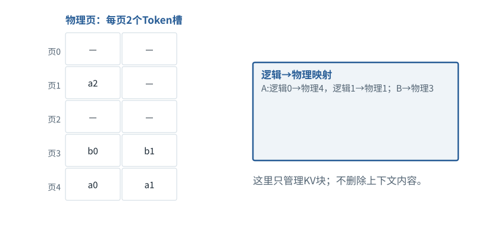

图解 · 运行过程 · 工程取舍

# PagedAttention：逻辑连续，物理可以分块

缓存为什么不必为每个请求找一大块连续显存？

动态图解 · O05

## PagedAttention：逻辑连续，物理可以分块

缓存为什么不必为每个请求找一大块连续显存？

类似把一本书分册放在不同抽屉，目录记录第几册在哪；阅读顺序仍由目录决定。分页把KV存储切块并维护映射，减少为不断增长的序列预留连续区域的浪费。它不是截短上下文，也不会自动减少该读的历史。

**逻辑页**按序列顺序排列的块号。

**物理页**实际存放KV数据的内存块。

**碎片**已分配空间里暂未使用的部分。

**输入与适用条件：**独立分配示例：5个物理页、每页2槽；A初始3项，B2项；图中槽位代表Token对应的一组KV，不是一个字节。

### 1 / 4 · 初始：A仅3个位置

停留时间 4.2秒7秒1.5秒

步骤 第1步，共4步

窄屏可左右滑动图形，或点击“放大图形”。文字解释紧随图后。

只有a0/a1/a2，第一帧的物理0仍未分配。

`A:逻辑0→物理4，逻辑1→物理1；B→物理3`

默认静止。用“下一步”看完解释再继续；播放到最后一步自动停止。键盘聚焦播放器后，可用左右键逐步查看、空格播放/暂停。图中颜色辅助区分，含义同时用文字注明。

JavaScript未启用；第一帧仍可阅读。完整图解页下方列出全部步骤说明。

## 逐步说明与计算记录

以下解释全部展开，与播放器使用同一份数据；不是另换输入的第二个算例。

### 1．初始：A仅3个位置

只有a0/a1/a2，第一帧的物理0仍未分配。

`A:逻辑0→物理4，逻辑1→物理1；B→物理3`

### 2．A追加第4项

a3填入物理1的剩余槽位，不必搬动历史a0/a1。

`A仍使用物理4与1；B使用物理3`

### 3．A再追加第5项

新分配物理0来保存a4；逻辑顺序a0…a4仍不改变。

`A:逻辑0→4，1→1，2→0`

### 4．释放一个请求

释放属于B的块；不能因为物理编号乱序就改变A的Token顺序。

`B完成，物理3可释放；A不变`

### 为什么需要

序列动态增长，连续预留常造成空间浪费并限制并发。

### 怎样实现

用固定大小块和映射管理增长、释放及条件允许的共享。

### 可能的代价与误解

仍有尾页空槽和管理开销；共享页写入需正确处理引用与复制。

### 如何判断是否做对

核对逻辑顺序、页所有权、增长和释放，确保不同请求不会混用内容。

[F19 · KV Cache：留下算过的，不省掉该读的](F16.md)[O06 · 连续组批：有座位空出来，就接下一位](O06.md)

机制来源：[[PAGED]](sources.md#s-PAGED)。数值和运行场景为本书明确设定的教学例；资料出处不代替本页中文解释。