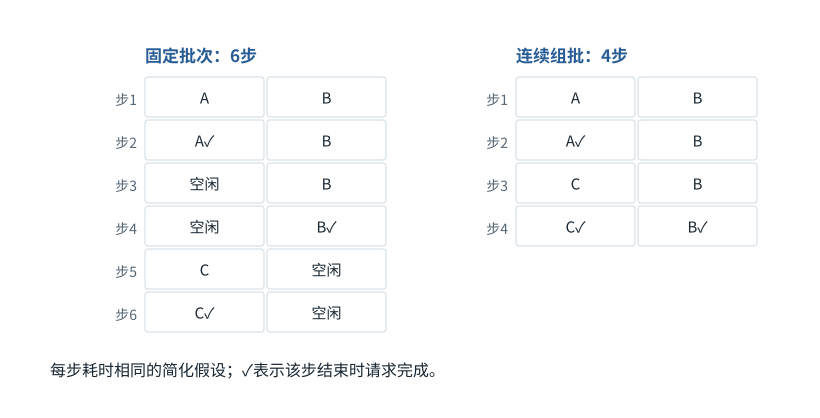

图解 · 运行过程 · 工程取舍

# 连续组批：有座位空出来，就接下一位

为什么设备更忙，不代表每条请求都更快？

动态图解 · O06

## 连续组批：有座位空出来，就接下一位

为什么设备更忙，不代表每条请求都更快？

固定批次像一车人必须一起离站；连续组批允许有人结束就补入新请求。这样减少空转，有机会提高吞吐。但已有请求的关键步骤未必缩短，新请求的预处理、排队与竞争还可能增加部分延迟。

**槽位**简化表示一次迭代能同时处理的请求位置。

**Prefill**新请求的完整已知输入处理阶段。

**公平性**避免某类请求长期等不到资源。

**输入与适用条件：**两槽位、三请求，A/B/C分别需2/4/2个等时decode步骤。忽略prefill和通信，只说明调度机制。

### 1 / 4 · 普通批次等待整体结束

停留时间 4.2秒7秒1.5秒

步骤 第1步，共4步

窄屏可左右滑动图形，或点击“放大图形”。文字解释紧随图后。

两槽位、请求A需2步、B需4步、C需2步且等待。普通批次中A完成后空出的位置仍要等B结束，再处理C。

`A2步；B4步；C2步；槽位2`

默认静止。用“下一步”看完解释再继续；播放到最后一步自动停止。键盘聚焦播放器后，可用左右键逐步查看、空格播放/暂停。图中颜色辅助区分，含义同时用文字注明。

JavaScript未启用；第一帧仍可阅读。完整图解页下方列出全部步骤说明。

## 逐步说明与计算记录

以下解释全部展开，与播放器使用同一份数据；不是另换输入的第二个算例。

### 1．普通批次等待整体结束

两槽位、请求A需2步、B需4步、C需2步且等待。普通批次中A完成后空出的位置仍要等B结束，再处理C。

`A2步；B4步；C2步；槽位2`

### 2．连续组批及时补位

A在第2步完成后，第3步把C放入空槽，与B一起继续。此理想小例总步数从6降到4。

`A2步；B4步；C2步；槽位2`

### 3．为什么不是所有用户延迟都减半

B仍然做4步；改变的是空闲槽利用。真实接纳新请求还涉及prefill与排队，不能把本图比例当通用加速。

`A2步；B4步；C2步；槽位2`

### 4．读吞吐也要看公平性

新长请求的prefill可能干扰正在decode的请求；限额、分块调度与公平性是后续要测的条件。

`A2步；B4步；C2步；槽位2`

### 为什么需要

不同请求长度不同，固定批次会浪费提前空出的计算位置。

### 怎样实现

在迭代边界移除完成请求、纳入候选，并用预算管理prefill/decode竞争。

### 可能的代价与误解

吞吐提升可能伴随首Token或长尾延迟上升，不能只看平均速度。

### 如何判断是否做对

同负载测吞吐、TTFT、逐Token延迟和尾延迟；单独报告排队。

[F21 · 算得慢，可能是东西搬得慢](F21.md)[F38 · Trace要告诉你因果，不只是时间戳](F38.md)

机制来源：[[CACHE]](sources.md#s-CACHE) [[PAGED]](sources.md#s-PAGED)。数值和运行场景为本书明确设定的教学例；资料出处不代替本页中文解释。