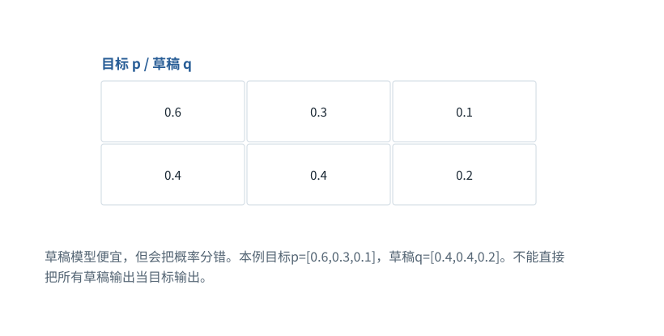

图解 · 运行过程 · 工程取舍

# 推测解码：草稿可以快，但必须正确校验

为什么“让小模型先写，大模型点头”还不够准确？

动态图解 · O07

## 推测解码：草稿可以快，但必须正确校验

为什么“让小模型先写，大模型点头”还不够准确？

草稿模型先给候选，目标模型负责校验。要保持目标采样分布，接受与拒绝后的补偿必须正确，不能只凭“看起来合理”保留草稿。草稿与校验也有额外成本，草稿命中低或任务很短时可能不划算。

**p**目标模型分布。

**q**草稿模型分布。

**接受率**在已提出某个候选条件下接受它的概率。

**补偿分布**拒绝后用于恢复目标总体分布的剩余概率质量。

**输入与适用条件：**独立的三候选、单步概率算例。实际多Token推测还要处理接受前缀、回退缓存和批量验证。本图不把它等同于贪心校验。

### 1 / 5 · 草稿分布与目标分布不同

停留时间 4.2秒7秒1.5秒

步骤 第1步，共5步

窄屏可左右滑动图形，或点击“放大图形”。文字解释紧随图后。

草稿模型便宜，但会把概率分错。本例目标p=[0.6,0.3,0.1]，草稿q=[0.4,0.4,0.2]。不能直接把所有草稿输出当目标输出。

`目标 p / 草稿 q`

默认静止。用“下一步”看完解释再继续；播放到最后一步自动停止。键盘聚焦播放器后，可用左右键逐步查看、空格播放/暂停。图中颜色辅助区分，含义同时用文字注明。

JavaScript未启用；第一帧仍可阅读。完整图解页下方列出全部步骤说明。

## 逐步说明与计算记录

以下解释全部展开，与播放器使用同一份数据；不是另换输入的第二个算例。

### 1．草稿分布与目标分布不同

草稿模型便宜，但会把概率分错。本例目标p=[0.6,0.3,0.1]，草稿q=[0.4,0.4,0.2]。不能直接把所有草稿输出当目标输出。

`目标 p / 草稿 q`

### 2．接受概率由两者比值决定

草稿选到A/B/C时，分别按1、0.75、0.5接受。更可能被草稿过度提出的项，需要更低的接受率。

`接受率 min(1,p/q)`

### 3．被接受的总质量还不够

草稿概率乘接受率，得到[0.4,0.3,0.1]，总和0.8。还有0.2需要从拒绝后的补偿分布分配。

`直接接受的概率质量`

### 4．拒绝后从剩余质量采样

正差p−q为[0.2,0,0]。归一化后补偿只能选A，补上总质量0.2；最终恢复[0.6,0.3,0.1]。

`待补的质量 / 最终分布`

### 5．走一次具体拒绝分支

设草稿提出B，接受阈值0.75；给定随机数0.9则拒绝，从补偿分布选择A。不是总从目标分布重新抽一次，也不是无条件保留B。

`本次接受判定`

### 为什么需要

用便宜草稿和批量验证减少目标模型逐Token串行负担。

### 怎样实现

正确计算接受概率与残差分布，维护接受前缀后的缓存位置。

### 可能的代价与误解

错误拒绝补偿会改变分布；草稿、校验和回退开销可能超过节省。

### 如何判断是否做对

本例接受质量0.8、补偿质量0.2，合起来必须逐项等于p。

[F09 · Softmax不是直接把分数除以它们的和](F09.md)[F18 · 一次输入如何连着预测，直到结束](F15.md)[F19 · KV Cache：留下算过的，不省掉该读的](F16.md)

机制来源：[[SPEC]](sources.md#s-SPEC)。数值和运行场景为本书明确设定的教学例；资料出处不代替本页中文解释。