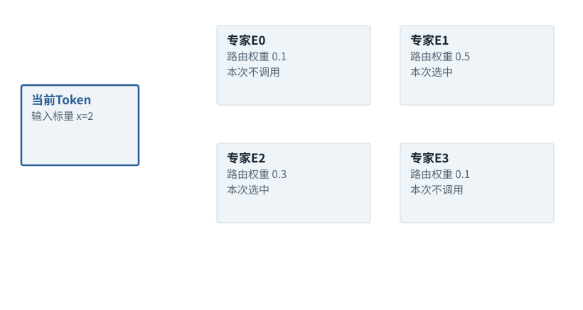

图解 · 运行过程 · 工程取舍

# MoE：每个Token选部分计算路径

为什么总参数很多，但每Token不用计算所有专家？

动态图解 · O08

## MoE：每个Token选部分计算路径

为什么总参数很多，但每Token不用计算所有专家？

像在一层里准备多个可选择的加工单元，路由器为每个Token挑其中一部分。稀疏指本次激活的路径，不是模型只剩几个专家参数。专家学到什么由训练决定，不能从名字推断某个一定专门处理数学或情感。

**Top-2**只选择分数最高的两条专家路径。

**负载不均**不同专家接到的Token数量不同。

**路由合并**将所选专家结果按指定规则组合。

**输入与适用条件：**四专家的教学Top-2结构，不复现Switch论文的Top-1配置。单Token权重[.1,.5,.3,.1]，两专家函数明确给定。

### 1 / 4 · 先算路由分数

停留时间 4.2秒7秒1.5秒

步骤 第1步，共4步

窄屏可左右滑动图形，或点击“放大图形”。文字解释紧随图后。

这是网络内部专家，不是四个独立聊天Agent。路由器按当前表示产生分配。

`本步状态由图形与说明共同给出。`

默认静止。用“下一步”看完解释再继续；播放到最后一步自动停止。键盘聚焦播放器后，可用左右键逐步查看、空格播放/暂停。图中颜色辅助区分，含义同时用文字注明。

JavaScript未启用；第一帧仍可阅读。完整图解页下方列出全部步骤说明。

## 逐步说明与计算记录

以下解释全部展开，与播放器使用同一份数据；不是另换输入的第二个算例。

### 1．先算路由分数

这是网络内部专家，不是四个独立聊天Agent。路由器按当前表示产生分配。

### 2．选择Top-2专家

本例选E1与E2，不计算E0/E3的输出；这些专家的参数仍存在于系统里。

### 3．合并实际专家结果

独立指定专家函数E1(x)=2x、E2(x)=x+3。输入2得到4和5，用归一后的0.625/0.375合并。

### 4．稀疏激活仍有代价

总体参数大而每Token激活较少，不等于所有设备负载均匀；路由、容量与跨设备传输都要计入。

### 为什么需要

在扩大总参数容量的同时限制每Token激活计算。

### 怎样实现

按路由规则分配与合并，并配合容量和负载管理。

### 可能的代价与误解

专家拥堵、跨设备通信、路由失衡、训练不稳定都可能抵消收益。

### 如何判断是否做对

测实际激活分布、掉Token/溢出策略、吞吐与任务质量。

[F20 · 省参数、省位数、少激活不是同一种优化](F20.md)[F32 · Skill存在，为什么仍可能完全没用？](F32.md)

机制来源：[[MOE]](sources.md#s-MOE)。数值和运行场景为本书明确设定的教学例；资料出处不代替本页中文解释。