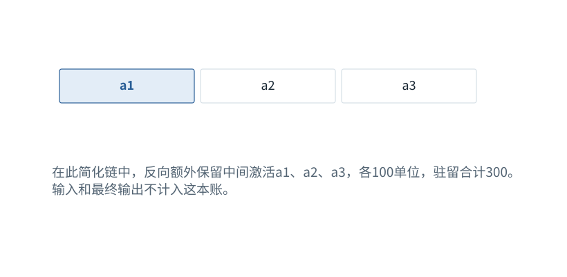

图解 · 运行过程 · 工程取舍

# Activation Checkpointing：少存一点，反向时重算

为什么有的优化是用时间换内存，而KV缓存恰好相反？

动态图解 · O09

## Activation Checkpointing：少存一点，反向时重算

为什么有的优化是用时间换内存，而KV缓存恰好相反？

训练反向需要一些前向中间结果。全部保留速度方便但占空间；检查点方法保存少量节点，需要时重算中间段。KV缓存则是推理中多存历史来少做重复工作。二者都叫缓存/检查点相关机制，却有不同方向的取舍。

**激活**一次前向计算产生的中间数值。

**反向重算**为求梯度重新执行某段前向。

**驻留与峰值**一直留着多少，与某时刻最多占多少，并不一样。

**输入与适用条件：**四段计算链的独立示意，只计三个各100单位的中间激活。实际峰值含其他张量与临时重算，必须实测。

### 1 / 5 · 普通保存

停留时间 4.2秒7秒1.5秒

步骤 第1步，共5步

窄屏可左右滑动图形，或点击“放大图形”。文字解释紧随图后。

在此简化链中，反向额外保留中间激活a1、a2、a3，各100单位，驻留合计300。输入和最终输出不计入这本账。

`只计a1/a2/a3；不宣称总峰值减少比例`

默认静止。用“下一步”看完解释再继续；播放到最后一步自动停止。键盘聚焦播放器后，可用左右键逐步查看、空格播放/暂停。图中颜色辅助区分，含义同时用文字注明。

JavaScript未启用；第一帧仍可阅读。完整图解页下方列出全部步骤说明。

## 逐步说明与计算记录

以下解释全部展开，与播放器使用同一份数据；不是另换输入的第二个算例。

### 1．普通保存

在此简化链中，反向额外保留中间激活a1、a2、a3，各100单位，驻留合计300。输入和最终输出不计入这本账。

`只计a1/a2/a3；不宣称总峰值减少比例`

### 2．只保留检查点

改为只留a2，反向开始前这三项中的驻留量变为100。这里说的是预先保留，不是运行峰值只有100。

`只计a1/a2/a3；不宣称总峰值减少比例`

### 3．先恢复后半段

从保存的a2重算a3，再进行后半段反向。此时a2与重算a3等会临时同时占内存。

`只计a1/a2/a3；不宣称总峰值减少比例`

### 4．再恢复前半段

需要前半段梯度时，从保留的输入重算a1。通过额外前向计算换取更少长期驻留激活。

`只计a1/a2/a3；不宣称总峰值减少比例`

### 5．为什么必须保持一致

重算应对应同一次前向。Dropout随机状态、参数更新时机和含副作用运算都可能破坏等价性。

`只计a1/a2/a3；不宣称总峰值减少比例`

### 为什么需要

训练激活内存可能限制序列长度或批大小。

### 怎样实现

保存关键节点，反向时重建中间激活并维持相同计算语义。

### 可能的代价与误解

额外计算、随机状态处理、不可重复副作用与重算峰值。

### 如何判断是否做对

比较开启/关闭后的损失与梯度，并分别测峰值内存和训练步耗时。

[F15 · 梯度像坡度，学习率像迈步大小](F17.md)[F16 · 训练：给每个位置一道“下一项”题](F18.md)[F21 · 算得慢，可能是东西搬得慢](F21.md)

机制来源：[[CHECKPOINT]](sources.md#s-CHECKPOINT)。数值和运行场景为本书明确设定的教学例；资料出处不代替本页中文解释。