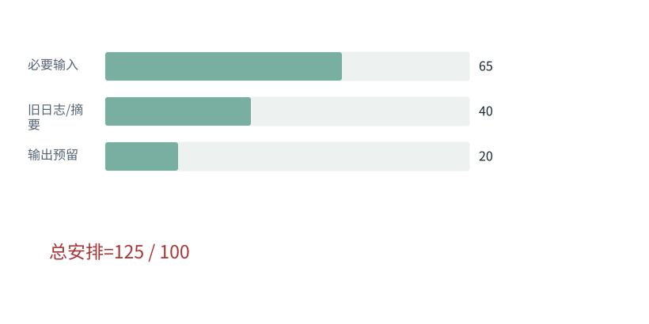

图解 · 运行过程 · 工程取舍

# 压缩、检索与Prompt Cache：三种不同的“省”

上下文短了、检索准了、缓存命中了，为什么不能混为一谈？

动态图解 · O10

## 压缩、检索与Prompt Cache：三种不同的“省”

上下文短了、检索准了、缓存命中了，为什么不能混为一谈？

摘要压缩改变模型看到的内容，可能损失信息；检索决定这次取回哪些外部证据，可能漏召回；Prompt Cache复用满足条件的既有计算，逻辑输入长度不因此自动缩短。判断风险先看它到底改的是内容、选择还是计算复用。

**输入压缩**替换或删除逻辑内容。

**检索**按本次问题从外部取回候选资料。

**前缀计算复用**相同且兼容的前缀可以复用已有计算。

**输入与适用条件：**独立预算对照，必要输入65、旧日志40、输出预留20、总窗口100；10单位摘要是教学设定，不是真实Tokenizer测量。

### 1 / 4 · 不区分内容，全塞进来

停留时间 4.2秒7秒1.5秒

步骤 第1步，共4步

窄屏可左右滑动图形，或点击“放大图形”。文字解释紧随图后。

必要输入65单位，加40单位旧日志，再预留输出20，总计125，超过本例100窗口。

`总安排=125`

默认静止。用“下一步”看完解释再继续；播放到最后一步自动停止。键盘聚焦播放器后，可用左右键逐步查看、空格播放/暂停。图中颜色辅助区分，含义同时用文字注明。

JavaScript未启用；第一帧仍可阅读。完整图解页下方列出全部步骤说明。

## 逐步说明与计算记录

以下解释全部展开，与播放器使用同一份数据；不是另换输入的第二个算例。

### 1．不区分内容，全塞进来

必要输入65单位，加40单位旧日志，再预留输出20，总计125，超过本例100窗口。

`总安排=125`

### 2．仅删日志可能丢失状态

把旧日志全删，虽然只剩85，但若日志里藏着“集成未测”，任务会失去关键状态。缩短不是唯一目标。

`总安排=85`

### 3．抽取可恢复状态

把40单位旧日志替换成10单位有来源的状态说明，总计95；原文可按引用重新读取。

`总安排=95`

### 4．输入更短仍需核验

新增摘要未必正确。核对约束、已完成/未完成、来源版本，并测试下一步行动不变。

`总安排=95`

### 为什么需要

减少上下文占用与重复推理成本，同时保持任务连续性。

### 怎样实现

选择合适的层：证据按需获取、历史有损摘要、稳定前缀计算缓存分别处理。

### 可能的代价与误解

把有损摘要当无损缓存；把命中缓存当作模型已永久学会；权限与版本变化后误用结果。

### 如何判断是否做对

分别比较内容保真、检索召回、缓存命中与任务成功率，而不是只报Token减少。

[F26 · 每轮上下文像一份有边界的工作资料](F26.md)[F27 · 压缩要保留行动所依赖的事实](F27.md)[F29 · 从两个候选列表，走到可用证据](F29.md)

机制来源：[[CONTEXT]](sources.md#s-CONTEXT) [[PCACHE]](sources.md#s-PCACHE)。数值和运行场景为本书明确设定的教学例；资料出处不代替本页中文解释。