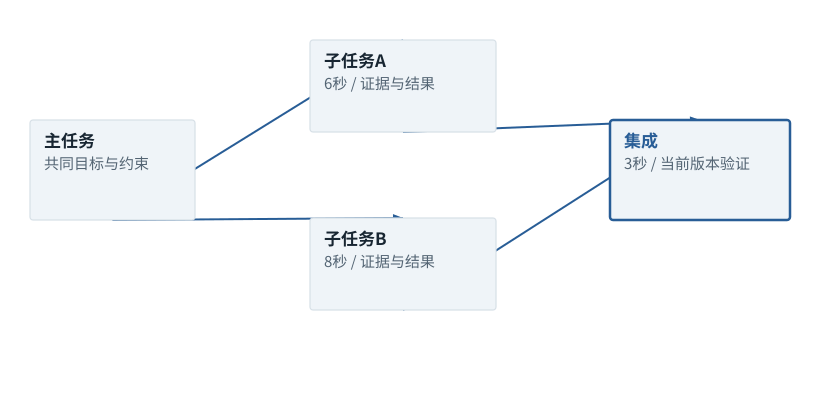

图解 · 运行过程 · 工程取舍

# 多Agent：可并行的工作，比Agent数量重要

为什么任务拆得更细，有时完成得更慢、更差？

动态图解 · O11

## 多Agent：可并行的工作，比Agent数量重要

为什么任务拆得更细，有时完成得更慢、更差？

并行能缩短独立子任务的关键路径，却增加委派、重复取证、结果整合和共享状态成本。子Agent拥有独立上下文还会引入交接损失。先找确实能分开的工作，再设计明确交接；简单集中任务往往单Agent更容易做好。

**依赖**某一步必须等待另一结果才能进行。

**交接包**目标、范围、证据、约束、当前状态与交付要求。

**冲突**多个执行者竞争同一份可变状态。

**输入与适用条件：**固定A6秒、B8秒、集成3秒；第二/三帧仅改变交接成本2→8秒。这是教学算账，不是商业多Agent实测。

### 1 / 4 · 顺序完成两个独立子任务

停留时间 4.2秒7秒1.5秒

步骤 第1步，共4步

窄屏可左右滑动图形，或点击“放大图形”。文字解释紧随图后。

任务A6秒、B8秒、集成3秒，顺序耗时17秒。先假定两项确实独立、都必需。

`交接开销=0秒；顺序=17秒`

默认静止。用“下一步”看完解释再继续；播放到最后一步自动停止。键盘聚焦播放器后，可用左右键逐步查看、空格播放/暂停。图中颜色辅助区分，含义同时用文字注明。

JavaScript未启用；第一帧仍可阅读。完整图解页下方列出全部步骤说明。

## 逐步说明与计算记录

以下解释全部展开，与播放器使用同一份数据；不是另换输入的第二个算例。

### 1．顺序完成两个独立子任务

任务A6秒、B8秒、集成3秒，顺序耗时17秒。先假定两项确实独立、都必需。

`交接开销=0秒；顺序=17秒`

### 2．并行也需要交接

并行关键路径max(6,8)=8秒，加交接2秒与集成3秒，合计13秒；不是同时启动就只用8秒。

`交接开销=2秒；并行理想总耗时=13秒`

### 3．交接成本过大就更慢

同样任务只把交接开销改为8秒，合计8+8+3=19秒，反而比17秒慢。

`交接开销=8秒；并行理想总耗时=19秒`

### 4．写同一文件不独立

若A/B都修改同一路径，还要避免覆盖、处理冲突并重新验证集成；此前的独立假设不再成立。

`交接开销=2秒；并行理想总耗时=13秒`

### 为什么需要

利用真正独立的研究或实现方向，并隔离无关上下文。

### 怎样实现

按依赖和写入边界分工，交接必要证据，主任务核验整合结果。

### 可能的代价与误解

重复搜索、同文件覆盖、相关错误和过度委派会提高时间与Token成本。

### 如何判断是否做对

与单Agent同任务同预算对照，记录集成缺陷和重做次数。

[F32 · Skill存在，为什么仍可能完全没用？](F32.md)[F34 · 测试是找反例，不是给代码盖绿章](F34.md)[F38 · Trace要告诉你因果，不只是时间戳](F38.md)

机制来源：[[MULTI]](sources.md#s-MULTI) [[AGENT]](sources.md#s-AGENT)。数值和运行场景为本书明确设定的教学例；资料出处不代替本页中文解释。