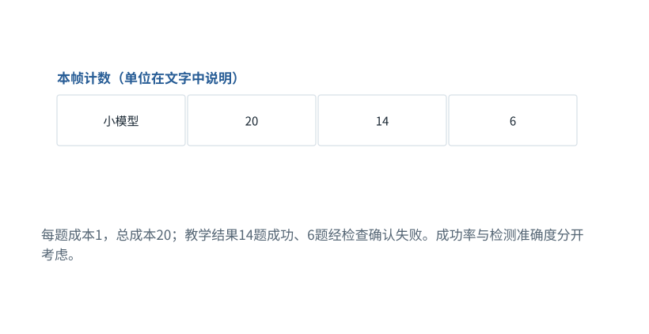

图解 · 运行过程 · 工程取舍

# 模型路由：便宜一次，不一定便宜一项成功任务

怎样判断换小模型是优化，还是把成本挪到返工？

动态图解 · O12

## 模型路由：便宜一次，不一定便宜一项成功任务

怎样判断换小模型是优化，还是把成本挪到返工？

一次调用单价低，只说明这次调用便宜。总成本还包括重试、升级、验证、人工修复和失败损失。级联能否划算，关键取决于小模型是否胜任可识别的一类任务，以及失败能否可靠检测。

**级联**先尝试较低成本方案，满足条件时升级。

**成功任务成本**总投入除以实际成功数，而不是调用次数。

**漏检**错误结果未被验证器识别，导致没有触发回退。

**输入与适用条件：**全为构造数据：20题、小模型单次1、强模型单次5；级联与全强模型的19题成功均为明确假设，不代表任何真实产品定价或胜率。

### 1 / 4 · 先给全部20题用便宜模型

停留时间 4.2秒7秒1.5秒

步骤 第1步，共4步

窄屏可左右滑动图形，或点击“放大图形”。文字解释紧随图后。

每题成本1，总成本20；教学结果14题成功、6题经检查确认失败。成功率与检测准确度分开考虑。

`先给全部20题用便宜模型`

默认静止。用“下一步”看完解释再继续；播放到最后一步自动停止。键盘聚焦播放器后，可用左右键逐步查看、空格播放/暂停。图中颜色辅助区分，含义同时用文字注明。

JavaScript未启用；第一帧仍可阅读。完整图解页下方列出全部步骤说明。

## 逐步说明与计算记录

以下解释全部展开，与播放器使用同一份数据；不是另换输入的第二个算例。

### 1．先给全部20题用便宜模型

每题成本1，总成本20；教学结果14题成功、6题经检查确认失败。成功率与检测准确度分开考虑。

`先给全部20题用便宜模型`

### 2．只把6个已确认失败送给强模型

每次升级成本5，追加成本30。假设6题中5题修复成功，总成本50，总成功19。

`只把6个已确认失败送给强模型`

### 3．用成功任务作分母

此教学级联成本50/19≈2.63；另设全用强模型同样成功19题，总成本100，成本100/19≈5.26。

`用成功任务作分母`

### 4．漏检会破坏这个收益假设

如果小模型说“完成”却实际错了，而验证器没发现，就不会触发升级。此时省钱可能以错误交付为代价。

`漏检会破坏这个收益假设`

### 为什么需要

在不降低可接受质量的前提下降低总投入。

### 怎样实现

用可验证的任务边界路由，保留明确回退与质量门槛。

### 可能的代价与误解

小模型失败未被发现、复杂任务被过早分流、重试成本和等待被忽略。

### 如何判断是否做对

报告成本/成功任务、漏检率、退化题和延迟分布；不以模型自报置信度作为唯一升级条件。

[F35 · 读指标，先问它的分母是谁](F35.md)[F36 · 涨了10个百分点，为什么还不能急着下结论？](F36.md)[F38 · Trace要告诉你因果，不只是时间戳](F38.md)

机制来源：[[EVAL]](sources.md#s-EVAL)。数值和运行场景为本书明确设定的教学例；资料出处不代替本页中文解释。