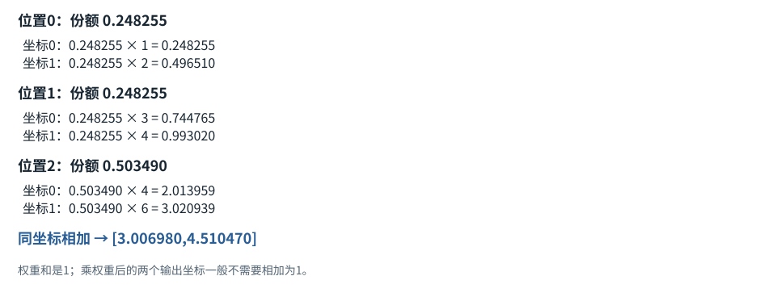
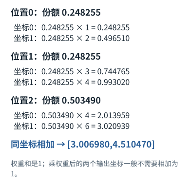
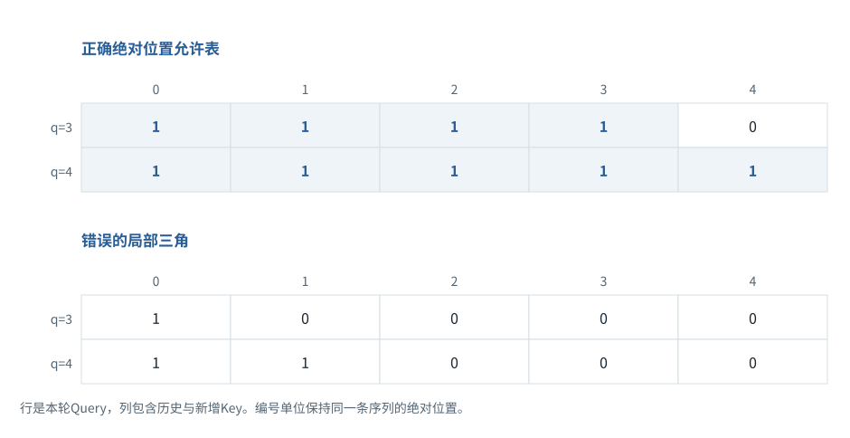
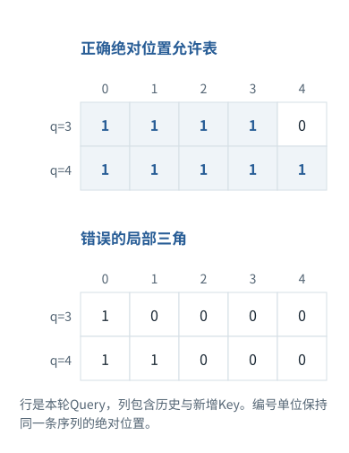

综合案例


<span id="walka-s0"></span>


# 全程拆解A｜一次输入怎样变成三个输出Token

连续案例的前置下面案例使用另一份词表8、两层网络的固定教学参数。它与起步查表页的词表6是两个实验，不能混用编号。

[F01 · 先分清](../foundations/01.md)[F02 · 一排数、一张表和一叠表](../foundations/02.md)[F03 · 文字为什么要先变成Token编号](../foundations/03.md)[F04 · 组批和补齐](../foundations/04.md)[F05 · Embedding查表](../foundations/05.md)[F06 · “放到设备”是什么](../foundations/06.md)[F07 · 模型最常做的算术](../foundations/07.md)[F08 · reshape、转轴、广播](../foundations/08.md)[F09 · 概率、指数与softmax](../foundations/09.md)[F10 · 神经网络最小模型](../foundations/10.md)[F11 · Attention逐步计算](../foundations/11.md)[F12 · Mask不是黑箱](../foundations/12.md)[F13 · 位置编号与RoPE](../foundations/13.md)[F14 · 把Attention装进一层](../foundations/14.md)[F18 · 从最后一排数到一个Token，再到一句回答](../foundations/18.md)[F19 · KV Cache从零解释](../foundations/19.md)

这不是把“[Tokenizer](../glossary.md#g029 "按模型配套规则把文本与Token编号相互转换的工具。 例：不能随意换分词器而保留不相容的模型参数。")→Transformer→输出”再画一遍。我们同时追踪四条线：请求对象怎样变、张量怎样变、缓存里有什么、程序下一步根据什么继续。最后把计算对应到包内能运行的代码。

**实验边界：**以下微型Decoder只有两层、宽度4、单头、词表8，使用固定合成权重和绝对位置项，未训练，不具备语言理解能力；它用于验证前向、位置、因果mask和缓存。产品消息模板、真实Tokenizer、[GPU](../glossary.md#g045 "适合大规模并行数值运算的处理器。 例：数据搬到GPU不改变编号语义，但消耗时间和显存。")内核不在这个实验中实现。概念依据见模型、缓存与工具接口来源。[[TR]](../sources.md#src-TR "来源说明")[[CHAT]](../sources.md#src-CHAT "来源说明")[[CACHE]](../sources.md#src-CACHE "来源说明")[[TOOLS]](../sources.md#src-TOOLS "来源说明")


<span id="visual-reading"></span>


<span id="topic-1"></span>


## 沿着对象与状态理解本章

一次预测完成只表示刚选出一个新Token。该Token还没经过自身的各层计算；继续生成时它才作为新输入。下图给出固定小模型的真实中间结果，并明确标出EOS如何终止循环，与最大长度截断分开。

下方图解的固定输入在“输入与适用条件”中声明。它用于解释本章机制，不与本章其他独立例子的数值暗中接续。


<span id="visual-F15"></span>

<span id="topic-2"></span>

<span id="topic-3"></span>

<span id="topic-4"></span>

<span id="topic-5"></span>

<span id="topic-6"></span>

<span id="topic-7"></span>


相关动态过程：[一次输入如何连着预测，直到结束](../visual/F15.md)。本节下文继续展示更具体的计算与工程边界。

继续看相关机制：[F09 · Softmax不是直接把分数除以它们的和](../visual/F09.md)[F19 · KV Cache：留下算过的，不省掉该读的](../visual/F16.md)[O07 · 推测解码：草稿可以快，但必须正确校验](../visual/O07.md)


<span id="walka-s1"></span>


## A.1｜用户界面的一句话，不是模型收到的全部输入

假设用户说“解释函数foo”。前端还持有选中的函数文本；宿主加载仓库规则和可用工具；它们构成消息对象。此时对象可能是字符串、结构化内容块、图片引用或工具定义，不是神经网络张量。

```
用户输入：“解释函数foo”
前端附件：选中源码、文件位置
宿主配置：系统规则、仓库指引、工具列表
会话状态：此前消息、当前任务进展
                 ↓ 上下文选择与序列化
模型可接收的消息与工具结构
                 ↓ 模型模板与Tokenizer
Token ID序列、位置、注意力约束
```

谁负责拿源码？可能是前端附件、宿主自动检索，也可能是模型先调用工具。不能从用户最终看到的回答倒推“它一定读了整个仓库”。观察实际请求清单与工具轨迹才能确认。

模板负责把角色与内容转成模型训练时能处理的形式。字符串里写“system:”并不天然等于真正的系统角色。真实产品还可能用专门的控制[Token](../glossary.md#g027 "模型分词器使用的片段单位。 例：可能是词、词的一部分、标点或部分字节。")或结构化通道。本实验从已编码的三个ID`[1,2,3]`开始，不虚构它们与某个中文短语的真实对应。


<span id="walka-s2"></span>


## A.2｜拿到ID之后，第一份浮点对象是什么

词嵌入矩阵E形状为`[8,4]`，三个ID取出三行，得到`[3,4]`。在一般[batch](../glossary.md#g034 "一起组织计算的一组输入。 例：普通样本batch不让不同用户相互读取内容。")记法中是`[1,3,4]`，程序省略了恒为1的batch轴。

本实验给每个位置加一个固定位置项：第p个位置第j维加`0.1·sin((p+1)/(j+1))`。这只是便于检查位置偏移的教学选择，不是[RoPE](../glossary.md#g082 "通过按位置旋转成对坐标来引入位置信息的方法。 例：二维90度旋转把[2,3]变为[-3,2]。")，也不是在声称现代LLM都把正弦直接加到[embedding](../glossary.md#g038 "按输入编号取出对应可学习向量的参数表及操作。 例：E形状[6,4]，编号2取E的第2行。")。

因此第一个张量H含两类信息：Token身份和位置。ID本身不是语义浮点向量；embedding参数决定ID怎样投影成可计算表示。推理时这里是查表，不是临时调用另一个Embedding检索服务。

此时有三个必须分开的数：词表8说明有8种Token；序列3说明本次有3个位置；宽度4说明每个位置有4个特征。把序列长度误当隐藏维度，会直接写错矩阵乘法。


<span id="mechanism-WA02"></span>


<span id="topic-8"></span>


### 沿用本案例：8项词表、3个位置、4个特征分别在哪里

只画A.2已经声明的词表[8,4]和输入[1,2,3]，不换成基础篇的6项词表。

沿用本案例：8项词表、3个位置、4个特征分别在哪里

| 对象 | 在本例里怎样定位 | 得到的大小 |
| --- | --- | --- |
| 词表E | 8种ID，各自存4个特征 | [8,4] |
| 本次ID | 按顺序取E[1]、E[2]、E[3] | 3个位置 |
| 查表结果 | 三行，每行仍4个数 | [3,4] |
| 位置项 | 第p行第j列加0.1sin((p+1)/(j+1)) | 形状不变，数值改变 |

查表减少的是被取出的行数，不是词表永久从8项缩到3项。下次输入仍能访问同一张8项表。

位置项直接加到取出的表示上；本案例这样做只是为了检查位置偏移，不等同于RoPE。后续缓存必须沿用本案例的同一位置规则。


<span id="walka-s3"></span>


## A.3｜进入第0层：先归一化，再生成Q/K/V

本实验使用pre-LN。对每个位置单独计算均值、方差并归一化：


<span id="concept-intro-3"></span>


先认识这里的对象与符号

[Σ：按下标逐项求和](../concepts.md#concept-sum)
:   Σ是加法的简写。下标指出哪项在变化；没有被求和的下标保持不变。它不是一个额外参数，也不表示把数组拼在一起。独立微例：Σᵢ xᵢyᵢ，x=[1,2]、y=[3,4]，就是1×3+2×4=11。


<span id="symbol-intro-1"></span>


先认识这里的对象与符号

[σ：看清函数符号与统计量](../concepts.md#concept-sigma)
:   在σ(XW+b)中，σ常泛指这一层选定的非线性函数；具体可以是ReLU等，不能仅凭σ认定是sigmoid。统计公式中σ常指标准差，σ²是方差。它们不是同一对象。独立例：σ若指定为ReLU，σ(-1)=0；若指定为sigmoid，则约0.268941。必须先给函数定义，才能算结果。

```
均值 μ = (x₁+x₂+x₃+x₄)/4
方差 σ² = Σ(xⱼ−μ)²/4
LN(x)ⱼ = (xⱼ−μ)/sqrt(σ²+ε)
```


<span id="concept-intro-4"></span>


先认识这里的对象与符号

[Norm、LayerNorm、RMSNorm：不是概率归一化](../concepts.md#concept-norm)
:   Norm在层公式中表示一个规范化函数。LayerNorm通常按一个Token的特征减均值、除标准差，再缩放平移；RMSNorm通常不减均值，按均方根缩放。它们不等于softmax。独立微例，忽略稳定分母用的小正数ε与可学缩放：LayerNorm([1,3])=[-1,1]；RMSNorm([1,3])=[1/√5,3/√5]。

这里只为简洁省略可学习缩放和偏移，不能据此推断完整[LayerNorm](../glossary.md#g085 "通常对每位置的特征计算均值方差并标准化，再用可学习尺度偏移。 例：[1,3]忽略epsilon时标准化为[-1,1]。")没有这些参数。归一化跨的是特征维，不是三个Token一起归一化；否则新增Token就可能改变旧位置数值，破坏后面缓存证明的前提。


<span id="concept-intro-1"></span>


先认识这里的对象与符号

[Wq / W\_Q：查询投影参数](../concepts.md#concept-q-projection)
:   这是把输入表示变为Query的参数矩阵，不是Query本身。按本书右乘约定，输入每行d个数、Wq有d行d\_k列，Q=XWq后每行有d\_k个数。下标q表示用途，不表示再乘一个q。同一Wq可处理多个位置；每个位置得到自己的q。F11给出X、Wq和每个乘加结果。

[Wk / W\_K：键投影参数](../concepts.md#concept-k-projection)
:   这是生成Key表示的模型参数表。K=XWk中的X来自当前注意力输入，K是这次算出的结果；Wk不是保存文档关键词或密钥的表。Q与K每行宽度要相同，才能做点积。在F11，x₁=[1,-1]乘Wk得到k₁=[0,1]。不是把原来的Token ID拿来当Key。

[Wv / W\_V：值投影参数](../concepts.md#concept-v-projection)
:   这是从输入生成Value内容向量的模型参数表。V=XWv之后，Attention按读取份额混合V的各行。Value的宽度d\_v可与Query/Key宽度d\_k不同；它不是最终词表答案。F11中同一x₁=[1,-1]乘Wv得到v₁=[0,20]，再参与加权求和。

[Query、Key、Value：三种中间数值表示](../concepts.md#concept-qkv)
:   q是接收信息的一行查询表示；k是可读位置提供的一行匹配表示；v是该位置供混合的一行内容表示。大写Q/K/V把多行收集成表。它们由输入与参数计算得到，分别承担打分与提供内容的职责。某个q与两个k点积得到两个分数；softmax得到两个份额；这些份额分别乘两行v，再相加。这里不生成搜索词，也不直接选答案。

归一化后的每行分别乘`Wq,Wk,Wv`，三者在本实验都是`[4,4]`。得到Q、K、V各`[3,4]`。它们由同一输入生成，但使用不同权重，因此不是同一份向量换个名字。

Q回答“当前查询要匹配什么方向”，K提供被匹配方向，V提供聚合内容。这是功能解释，不意味着维度天然对应人类可读概念。训练会共同调整这些投影，使最终预测目标更好。


<span id="walka-s4"></span>


## A.4｜怎样确保第1个位置看不到第3个位置

三个位置的分数矩阵是`QKᵀ/√4`，形状`[3,3]`。第i行是第i个查询对所有[Key](../glossary.md#g073 "每个可读位置用于被查询比较的一组数。 例：与Q点积得到匹配分数。")的分数。因果mask是：

```
位置0：[允许，禁止，禁止]
位置1：[允许，允许，禁止]
位置2：[允许，允许，允许]
```

被禁止位置在[softmax](../glossary.md#g062 "将各分数取指数，再除以所有指数之和。 例：分数[2,1,0]经Softmax后约为[0.6652,0.2447,0.0900]。")前视为负无穷，概率为零；不是先对全部位置softmax再随便清零，否则剩余概率未必归一化，且如果其他路径使用了未来信息仍会泄漏。

训练中可以同时计算三个位置，因为所有输入已给定，mask负责限制依赖。生成中没有未来Token，所以要逐步获取它们。**并行计算位置与允许访问未来，是两个不同问题。**

mask之外还可能有[padding](../glossary.md#g035 "给短序列增加占位项，使指定组织方式可用。 例：[4,2]右补齐为[4,2,0]。")限制。一个左填充batch中，逻辑位置和数组下标不一定相同；不能只用数组长度当位置。实验没有padding，从而把因果和缓存问题单独隔离出来。


<span id="walka-s5"></span>


## A.5｜一行注意力到底做了什么：完整手算

为了看清数字，暂用更小的二维局部例子，和四维Decoder区分开：

```
当前Q = [1,1]
历史K = [[1,0], [0,1], [1,1]]
历史V = [[1,2], [3,4], [4,6]]
```

点积是1、1、2，除以√2后约0.707107、0.707107、1.414214。为了稳定计算，统一减去最大值，指数变成`exp(−0.707107),exp(−0.707107),1`。归一化得到：

```
a = [0.24825508, 0.24825508, 0.50348984]
```

输出第一维为`0.24825508×1+0.24825508×3+0.50348984×4≈3.00697968`；第二维为`0.24825508×2+0.24825508×4+0.50348984×6≈4.51046952`。包内数值程序给出完整浮点结果。

这里输出的是特征向量，不是Token，也不是“选中了第三个词”。虽然第三个权重最大，前两个仍有贡献；向量随后还会经过输出投影与后续网络。这个例子解释了为什么单看注意力热度不能完整解释最终答案。


<span id="mechanism-WA05"></span>


<span id="topic-9"></span>


### 把A.5的三个位置贡献分别画出来

严格沿用A.5独立二维例：q=[1,1]，K=[[1,0],[0,1],[1,1]]，V=[[1,2],[3,4],[4,6]]。不是四维Decoder的隐藏状态。

把A.5的三个位置贡献分别画出来





这里沿用当前贯通案例的对象与数值；没有切换为其他章节的独立算例。

三个份额分别乘自己的Value，而不是把最大份额的位置整行复制出来。先按每个输出坐标看贡献，再把同一坐标相加。

第三个位置份额最大，但前两项仍贡献输出。若要解释最终词，后面还要经过Wo、残差、前馈网络和词表输出头。


<span id="walka-s6"></span>


## A.6｜注意力之后还发生什么，为什么不能直接输出文字


<span id="concept-intro-2"></span>


先认识这里的对象与符号

[Wo / W\_O：注意力输出投影](../concepts.md#concept-wo)
:   把各注意力头输出拼接后，再转换成主网络需要宽度的参数矩阵。它仍是一张系数表，不是softmax的份额，也不是词表输出头Wout。若两个头各输出2个数，拼接宽度4；右乘形状[4,6]的Wo，可得到6个数以匹配残差宽度。此为独立形状例。

[SwiGLU、Wg/Wu/Wd：两路变换再合成](../concepts.md#concept-swiglu)
:   这是门控前馈结构。Wg生成要过SiLU的一路，Wu生成另一条内容路径，两路逐元素相乘，再用Wd映回原宽度。这些W是三组参数，不是三个Agent。读(SiLU(XWg)⊙XWu)Wd时，先算XWg和XWu，再SiLU，再⊙，最后乘Wd。每个位置独立用同一组参数。

回到四维Decoder：每个位置的聚合向量乘Wo，得到宽度4，再与该层原输入做残差相加。随后第二次归一化，经过`4→8→4`的前馈网络，本实验用[ReLU](../glossary.md#g068 "不同的非线性激活函数。 例：ReLU(x)=max(0,x)，另外两者有平滑曲线。")，最后再加残差。实际模型可能用[SwiGLU](../glossary.md#g089 "以一个分支产生的值调节另一个分支输出的前馈结构。 例：不是“挑一个词通过”，而是逐数值调制。")等其他结构。

```
H0
  ↓ LN → QKV → attention → Wo
  + H0
  = R0
  ↓ LN → Wup → ReLU → Wdown
  + R0
  = H1
```

第1层接收H1，执行同样的结构，但使用另一组权重。第1层K/V不是第0层K/V的复制品；它们来自更深的上下文化表示，所以每层缓存都必须分别保存。

[FFN](../glossary.md#g088 "通常在每个位置应用的前馈子网络。 例：常把宽度先扩展再缩回，带非线性或门控。")逐位置作用，不在此处直接混合不同Token，但它会变换已经聚合的特征。把“注意力负责理解、FFN只是无关附属”当成答案是不准确的。最终能力来自整个网络共同训练。


<span id="walka-s7"></span>


## A.7｜第一个输出Token从哪里来

两层结束后，最终归一化表示乘语言模型输出矩阵`[4,8]`，得到每个位置的8个[logits](../glossary.md#g091 "输出投影给各词表候选的未归一化分数。 例：可以是负数，还不是概率或Token编号。")。三个输入位置得到`[3,8]`，其中最后一行用于预测紧接输入的第一个输出Token。

包内实际运行的最后一行约为：

```
[-0.052135, -0.102202, -0.101966, -0.051542,
  0.024250,  0.088107,  0.108598,  0.075637]
```

选择贪心解码时，最大值位于ID6，所以输出第一个Token是6。这里不需要先进行一次“空decode”才能拿到第一个Token：[Prefill](../glossary.md#g098 "处理当前已经知道的一段输入前缀。 例：得到各层表示及可复用的K/V。")已产生最后位置的预测分布。


<span id="concept-intro-7"></span>


先认识这里的对象与符号

[Top-k、Top-p与重新归一化](../concepts.md#concept-topk)
:   Top-k保留概率最高的k项；Top-p按概率降序保留累计概率达到阈值的候选前缀。用于抽样时，被保留的候选需按剩余总质量重新归一化。这里k是候选数量，p是累计概率阈值；不是注意力Key表K，也不是表示维度d\_k。

采用采样时还要按温度、[top-k](../glossary.md#g095 "分别按候选个数或累计概率保留候选的策略。 例：筛选后通常还要重新归一化。")/[top-p](../glossary.md#g095 "分别按候选个数或累计概率保留候选的策略。 例：筛选后通常还要重新归一化。")等规则处理分布。温度改变分布，不改变已经算出的历史K/V。若Token对应文本字节片段，显示层还要正确处理多字节字符和控制Token，不能把每个Token都当作一个完整汉字。

**此刻缓存长度仍是3，不是4。** 网络刚处理的是输入`[1,2,3]`；ID6是由输出分布选择的结果，还没有经过各层计算，所以尚无它自己的K/V。


<span id="walka-s8"></span>


## A.8｜第二个Token：只输入刚才的ID6

下一步把ID6送回模型，逻辑位置为3。查embedding并加位置项后，得到`[1,4]`。第0层只对这个位置计算新Q/K/V，把新K/V追加到已有3行后，缓存变成`[4,4]`。

新Q形状`[1,4]`，乘历史加当前的K转置`[4,4]`，分数是`[1,4]`，不是再次生成整个`[4,4]`查询分数矩阵。随后softmax、V聚合、残差、FFN，进入第1层。第1层用自己的历史缓存重复这个过程。

实际新logits约为：

```
[0.232867, -0.009785, -0.247622, -0.363579,
 -0.300585, -0.089644, 0.165419, 0.339064]
```

贪心会选择ID7作为第二个输出。此刻缓存长度4，覆盖`[1,2,3,6]`，不包括刚选出的7。要预测第三个输出，再送入ID7，位置4，各层缓存增长到5。实验可以直接继续这一步；这里强调时间线，而不是把这些无语言意义的ID包装成真实答案。


<span id="walka-s9"></span>


## A.9｜完整时间线：序列、缓存与输出错一位会怎样

| 时点 | 本轮实际送入 | 本轮结束缓存覆盖 | 本轮选出的输出 |
| --- | --- | --- | --- |
| Prefill | 1,2,3 | 1,2,3 | 6 |
| Decode 1 | 6 | 1,2,3,6 | 7 |
| Decode 2 | 7 | 1,2,3,6,7 | 下一输出ID |


<span id="symbol-intro-3"></span>


先认识这里的对象与符号

[BOS / EOS：序列边界标记](../concepts.md#concept-bos-eos)
:   BOS通常表示序列起始，EOS表示结束的特殊Token；具体模型和消息模板可能使用不同名称、数量及结束标记。它们是输入/输出协议中的符号，不是语义正确性的证明。遇到EOS不自动切断两个训练样本之间的注意力；要隔离读取还需mask或实现支持的样本边界。

若调用者把整段`[1,2,3,6]`和旧缓存一起送入一个只接受新Token的接口，就可能重复追加前缀；若把位置重置为0，位置编码错误；若生成[EOS](../glossary.md#g096 "模型约定的一种结束序列Token。 例：与最大输出长度、用户取消是不同结束原因。")后还盲目执行工具，则把语言停止和执行状态混淆。

框架有时会自动裁剪已缓存输入，但这属于接口约定。自己实现时要明确接受的是“全输入”还是“增量后缀”，不要依赖猜测。缓存对象还应绑定模型/adapter身份，否则换权重后沿用旧状态会得到不一致结果。


<span id="mechanism-WA09"></span>


<span id="topic-10"></span>


### 同一条ID序列：选中与已经处理相差一步

本图只采用A.7—A.9的实际ID结果；ID6和ID7不强行解释成某个中文词。

同一条ID序列：选中与已经处理相差一步

| 模型调用 | 本轮处理后缓存覆盖 | 本轮刚选择 |
| --- | --- | --- |
| Prefill输入[1,2,3] | [1,2,3]，长度3 | 6 |
| Decode输入[6] | [1,2,3,6]，长度4 | 7 |
| Decode输入[7] | [1,2,3,6,7]，长度5 | 下一输出ID |

沿第二列数缓存：它记录已经经过模型各层的Token。第三列是这次结果，还没有自己的K/V。

如果下一轮把整个前缀与旧缓存同时交给仅接收后缀的接口，会重复追加。传入完整序列还是增量后缀，必须按具体接口约定。


<span id="walka-s10"></span>


## A.10｜一次处理两个新Token时，mask为什么不是普通小三角

已有P=3个缓存，新增C=2个Token。Q是`[2,4]`，K是`[5,4]`，分数`[2,5]`。正确mask：

```
新位置3：[1,1,1,1,0]
新位置4：[1,1,1,1,1]
```

直接生成`tril(ones(2,5))`却得到`[1,0,0,0,0]`与`[1,1,0,0,0]`，新查询看不到大部分历史和自身。这个Bug不会总是报维度错误，而是悄悄改变输出，非常适合面试追问“代码能跑为何不对”。

正确条件是`key_position ≤ past_length + query_index`，再合并padding或滑动窗口约束。包内测试同时比较全量前向与单Token/双Token增量前向，并故意用错误位置产生差异，证明测试能发现特定错误，而不只证明程序不崩溃。


<span id="mechanism-WA10"></span>


<span id="topic-11"></span>


### 两个新增Query应当怎样读取五个Key

严格沿用A.10：已有3位置，新增2位置。只画可见性，不给四维Decoder编造新的Value数字。

两个新增Query应当怎样读取五个Key





这里沿用当前贯通案例的对象与数值；没有切换为其他章节的独立算例。

Query在本次数组里编号0，并不代表它是整条序列的位置0。加上past\_length=3，它才是位置3。

正确规则是Key绝对位置≤Query绝对位置；可见范围错了，即便矩阵维度正确也会悄悄改变输出。


<span id="walka-s11"></span>


## A.11｜如何证明缓存实现正确，而不是“生成的句子看起来正常”


<span id="symbol-intro-2"></span>


先认识这里的对象与符号

[Dropout：训练中的随机置零规则](../concepts.md#concept-dropout)
:   常用倒置Dropout在训练时按丢弃概率p随机将元素置零，保留项除以1-p以保持期望量级。评估模式通常关闭这一随机操作；底层函数可能要求调用者显式传p=0。独立例：p=0.5，某值2在一次掩码中被保留则输出4，被丢弃则0。这不是训练把对应模型参数永久删掉。

固定权重、关闭随机dropout、使用相同Token序列，分别运行全量前向与分段缓存前向，比较对应位置logits，设置合理浮点容差。再覆盖不同分段长度、位置偏移和前缀编辑。

若不相等，按顺序检查：输入是否重复、位置是否偏移、mask是否对齐、每层缓存是否正确、K是否在正确阶段应用位置变换、batch/padding是否混淆。不要先调采样温度，因为错误在分布生成之前。

本包测试还使用有限差分检查注意力对Q的解析梯度。这验证一个局部反向公式，不代表完整训练正确。把验证范围写清楚很重要：前向一致性、梯度检查、训练收敛、任务泛化是四种不同证据。


<span id="walka-s12"></span>


## A.12｜把这个例子迁移到真实模型时，必须补上什么


<span id="concept-intro-5"></span>


先认识这里的对象与符号

[MHA、MQA、GQA：头怎样共享](../concepts.md#concept-heads)
:   一个注意力头是一套匹配并聚合内容的路径。MHA常让每个Query头有自己的K/V头；MQA让多个Query头共用一组K/V；GQA在两者之间，分组共享。它们是结构选择，不是运行时随便改一个开关。独立形状例：8个Query头、2个K/V头，若均匀分组，每4个Query头共享1组K/V；缓存按K/V头数记账。


<span id="symbol-intro-4"></span>


先认识这里的对象与符号

[MLA：学习得到的低维K/V表示](../concepts.md#concept-mla)
:   MLA指多头潜在注意力的一类架构。用较低维的潜在表示联合组织K/V相关内容，并按设计处理位置部分。它改变模型表示与参数结构，不只是把普通KV文件用ZIP压缩。读c=xW\_down时，c是这次计算的潜在向量，W\_down是学到的降维系数表；后续如何重构或吸收投影须按具体架构解释。

真实系统需要更大的参数、多个头或[GQA](../glossary.md#g127 "不同查询头与K/V头共享方式的注意力结构。 例：共享更多K/V可减少缓存，但不保证质量完全相同。")/MLA、真实Tokenizer、训练过的权重、模型对应的归一化和激活、正确位置方案、批处理、精度与设备内核。服务还要管理请求取消、KV分页、前缀共享和资源限制。


<span id="concept-intro-6"></span>


先认识这里的对象与符号

[FlashAttention：改变中间数据存取方式](../concepts.md#concept-flash)
:   通过分块和在线归一化等方式，避免把完整注意力分数/权重矩阵长期写到较慢显存；目标仍是同一个注意力运算，浮点舍入可随运算次序变化。它不是把Token永久压缩，也不是跳过所有Key。区分“不把整张表落显存”与“没有进行这些数学计算”。

但诊断方法不变：先明确接口契约和每一步对象，再做可对照的小规模验证，最后测性能。不能因为某技术叫[FlashAttention](../glossary.md#g131 "通过分块和更有效内存访问计算注意力的一类实现。 例：不是稀疏注意力，也不是把旧历史摘要掉。")就省略数值检查，也不能因为KV公式算得对就断言显存足够容纳所有并发。

本例的回答标准是：能够不看图，把从消息到ID、从ID到各层张量、从最后logits到采样、从新Token到增量缓存逐步讲出来，并说明每一处“已计算”和“尚未计算”的边界。

连续数值案例：[把同样两句话从Embedding一直算到输出概率，再验证KV缓存](../worked-model.md)。适合完成F01—F19后阅读。

AI系统工程：从基础到内部  
[全书目录](../contents.md) · [术语与符号](../glossary.md) · [参考资料](../sources.md)